# Auto PR Triage

Auto PR Triage runs on every non-draft pull request when it is opened, marked
ready for review, or pushed to. Intake decides whether a pull request takes no
action, is marked as missing an actionable issue, or is routed to reviewers;
ownership analysis combines deterministic codepath rules with LLM-suggested
semantic owners; planning turns both into one plan, which live mode applies. The code and its docstrings describe how each stage works. This
file keeps only what the code cannot show: goals, accepted tradeoffs, the
reasons behind some rules, and operating notes.

The editable source is [`overview.mmd`](overview.mmd).

## Goals and non-goals

The design aims to:

- apply a deterministic intake policy;
- preserve codepath ownership as the review baseline while adding semantic
  ownership;
- select configured reviewers while reusing review coverage that already
  exists;
- produce an exact, inspectable plan in the read-only job, whether or not live
  mode applies it; and
- run the same code in different repositories using their checked-in
  configuration.

It does not aim to:

- judge whether a pull request is correct, useful, or ready to merge;
- eliminate human triage when ownership is missing or uncertain;
- provide a transactional view of GitHub state or automatically reconcile every
  change that occurs after analysis;
- guarantee perfect semantic assignments or a perfectly even reviewer load; or
- create required labels or ownership configuration automatically.

## Design principles

- **Separate intake from ownership.** Repository policy determines whether a
  pull request proceeds to routing; ownership analysis determines who should
  review it.
- **Keep ownership additive.** Semantic ownership supplements rather than
  replaces codepath ownership.
- **Plan once, then apply.** Analyze reads pull-request, ownership, and reviewer
  state once and plans the exact effects; apply only executes a validated plan.
- **Plan against what already happened.** Each push runs again, and a run only
  adds requests and labels, apart from removing `missing actionable issue` once
  a PR meets policy. So a run never asks anyone who was ever requested on the PR
  (a removed request stays removed), and never marks a triaged PR as missing an
  actionable issue.
- **Leave uncertainty for people.** Missing information cannot mark a PR as
  missing an actionable issue, and incomplete routing is reported for human
  follow-up.
- **Keep writes out of shadow.** Shadow and live compute the same plan; shadow
  never runs a job that can write to GitHub.

## Accepted stale-result risk

Auto PR Triage intentionally does not close races by re-reading mutable GitHub
state. Intake, ownership analysis, and planning each read once, and apply
executes the plan without further reads, so separate calls can observe
different moments and later changes are ignored for that run.

This is a deliberate complexity and availability tradeoff, not a missing
security check. A run can make a stale but bounded mutation: request a
configured reviewer, or add one of the bot's own labels, such as marking a PR
as missing an actionable issue after it gained one. These effects are accepted
because maintainers can remove review requests and labels or rerun the
workflow, and the labels and artifacts make every action visible. Security
review should judge whether the mutation set stays bounded rather than expect
transactional consistency across jobs. Do not "fix" the staleness by adding
uncoordinated race-closing reads to apply.

## Security model

- `pull_request_target` runs only workflow and action code from the default
  branch, whatever the PR's base, and the PR head is fetched as data, never
  checked out or run.
- The LLM has no GitHub token and no file, shell, web, MCP, plugin, or subagent
  capability; its Bedrock session can only invoke the model.
- The write-capable job runs only in live mode and receives only the bounded
  `ActionPlan`. Rationale and diff evidence stay in the analyze job as log
  provenance and never choose reviewers, labels, or effects.
- User-controlled text never becomes a shell argument, label, or comment.
  Issue numbers and logins parsed from the PR body reach read-only API paths
  and the supporter request only after pattern validation.
- New reviewer requests come from trusted configuration, a verified supporter
  claim, or the actor who applied `actionable` to an admitting issue; the last
  two must have current triage-or-higher access.
- LLM output can keep a PR from being marked as missing an actionable issue,
  through a bypass match, but can never cause the mark. A prompt injection in the PR text can at worst keep a PR open and route it to
  a team that configured `bypass_intake_criteria`, bounded to that team's
  roster. Bypass claims need the same verified diff evidence as any owner, and
  only teams that opt in are exposed.
- Structural checks cannot prove the LLM's judgment correct: an LLM error or
  injection can omit a legitimate additional owner or suggest an unnecessary
  configured one. Live effects stay bounded to configured reviewers and the
  bot's labels; the only label a plan can remove is `missing actionable issue`,
  and only from an admitted PR; no plan can close a PR or post a comment.

## Why some rules are the way they are

- **Linked issue timelines do not count as maintainer activity.** Maintainers
  label and comment on most issues during triage, so that activity would admit
  any PR that merely mentions a triaged issue. Only the PR's own timeline is
  read.
- **Deployments are passive timeline events.** GitHub attributes a deployment
  to whoever triggered the workflow run, including this workflow's own
  environment-gated job, so it says nothing about deliberate maintainer action.
- **Codepath and semantic owners are not handoff reviewers.** A path match can
  come from an incidental edit and says nothing about an uncovered concern. A
  team whose bypass intake matched does count, because it asked for these PRs.
- **Every push runs again.** Ownership follows the diff, so a push that touches
  new files can need new owners. Runs on one PR never overlap, and each plans
  against the labels and reviewers the previous one left, so repeating a run
  changes nothing.
- **Once a PR meets policy, `missing actionable issue` is removed.** The mark
  answers the PR as it was, and an author who links an actionable issue later
  gets reviewers like any admitted PR. The reverse never happens: a triaged PR
  is not marked later, and a failure on any run still adds `bot-triage-error`.

## Codepath owners come from OWNERSHIP.yaml

GitHub doesn't send its own CODEOWNERS review requests: `CODEOWNERS` is generated
from `OWNERSHIP.yaml` into `scripts/codeowners/CODEOWNERS`, outside the paths
GitHub reads. Planning requests codepath owners instead, on every run and
whether or not the PR is admitted, as GitHub's native requests did: everyone on
the path's last matching rule, except the author, owners without push access,
and anyone pending, who has reviewed, or who was ever requested on the PR. It
reads the rules from `OWNERSHIP.yaml` in the generated file's order
(`ordered_groups` in `generate_codeowners.py`), so both agree on which rule
matches a path last. Requests go out with `GITHUB_TOKEN`, which can't request
teams or map emails to logins, so `OWNERSHIP.yaml` allows only user logins.

The same rules tell the LLM which changed files are already owned, and in
planning a team whose roster member is a requested codepath owner needs no
roster pick. The explanation reports each codepath owner's state: requested by
this run, already pending, reviewed, requested before, without push access, or
not requested because reviewer state couldn't be read.

## Operating notes

- **Prerequisites.** The default branch needs the workflow and composite action,
  `OWNERSHIP.yaml`, the two files in `.github/auto-pr-triage/`, and the
  `actionable`, `triaged`, `bot-triaged`, `bot-triage-error`, and `missing
  actionable issue` labels. The workflow does not create labels.
- **Shadow mode** makes no changes, so every run plans as if earlier runs hadn't
  happened. Labels such as `bot-shadow-close` and `bot-shadow-triaged` from
  earlier shadow runs mean nothing to planning.
- **Rerunning.** The next push runs Auto PR Triage again. To run it without a
  push, rerun all jobs of the PR's latest run; rerunning only the apply job is
  rejected because its plan may be stale. A rerun never marks a PR as missing an
  actionable issue: only the first attempt of a run can, and a rerun leaves an
  unadmitted PR for a human. `bot-triage-error` stays until someone removes it;
  removing it isn't needed for the next run.
- **Opting out.** A PR labeled `no automated triage` is left as is: a run that
  starts while the label is present is a no-op, including codepath owner
  requests, and the PR stays in the manual triage queue. Adding the label
  mid-run does not cancel that run. Once the label is removed, the next push
  runs Auto PR Triage again.
- **Failures in shadow mode** are visible only as a failed workflow run and its
  artifacts. In live mode the error-reporting job adds `bot-triage-error` on a
  best-effort basis.
