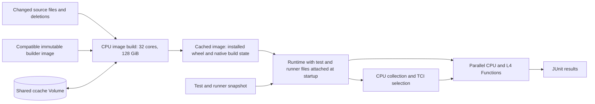

Ramjet builds a CUDA-enabled PyTorch wheel in a CPU-only Modal Image build, installs it into that image, and runs TCI tests on CPU and NVIDIA L4 workers using the finished image. An unchanged build reuses its completed image; source changes extend a compatible earlier image containing the native build directory. CUDA compilation needs the toolkit and an explicit target architecture; it does not need a GPU. The shared wheel uses CUDA 13.2 and `TORCH_CUDA_ARCH_LIST=7.5;8.9`, covering L4 and the original Tesla T4 pilot.



`Image.run_function` is the Modal API for a build step that needs explicit CPU, memory, timeout, and Volume resources. Its filesystem changes become a cached image layer. The GPU is requested only on the test Function, after the image build and CPU collection have completed. Installing the wheel during the image build avoids paying GPU rates for installation on every test worker. Test workers use `/opt/ramjet` as their working directory and Python import path, so the retained source tree at `/opt/pytorch` does not shadow the installed wheel.

The runner is [ramjet.py](ramjet.py), with source preparation in [ramjet_source.py](ramjet_source.py) and CPU build steps in [ramjet_build.py](ramjet_build.py). Its wheel command is `pip wheel . --no-deps --no-build-isolation -v`, executed on the CPU builder.

Use the existing project environment with the Modal SDK installed and an authenticated Modal profile:

```bash
source .venv/bin/activate
python -m tools.ramjet test/test_jit.py::TestScript --dry-run
python -m tools.ramjet test/test_jit.py::TestScript
```

Targets are optional. With none supplied, Ramjet uses the current directory. From the repository root this selects `test/`, matching `pytest.ini`; from a nested test directory it selects that subtree. Explicit relative paths are also resolved against the current directory. Targets can be Python files, directories, classes, or individual tests under `test/`:

```bash
python -m tools.ramjet

python -m tools.ramjet \
  test/test_jit_legacy.py::TestScript::test_tensor_to_cuda \
  test/test_jit.py::TestScript

python -m tools.ramjet test/typing test/test_jit_legacy.py::TestScript
```

This positional API replaces `--target`. Overlapping targets are deduplicated for each platform. Tests inheriting `common_utils.TestCase` also inherit its CPU and L4 declarations; unmarked tests and tests with an empty effective platform set are excluded even when explicitly requested. A test eligible on both default platforms runs once on CPU and once on L4. If no supported TCI tests match, Ramjet reports an error before starting test workers. Invalid paths and selectors also fail rather than silently broadening the selection.

Use repeatable `--platform` options to restrict execution. CPU collection and the CPU wheel build are unchanged by this selection:

```bash
python -m tools.ramjet --platform cpu test/test_tci.py
python -m tools.ramjet --platform l4 test/test_jit.py::TestScript
python -m tools.ramjet --platform cpu --platform l4 test/complex_tensor
python -m tools.ramjet --platform t4 test/test_jit_legacy.py::TestScript
```

By default, Ramjet leaves worker caps unset and lets Modal autoscale subject to workspace limits and available capacity. A workspace capacity warning means excess work can queue until containers or GPUs become available; it does not by itself mean tests failed. Modal SDK 1.6.1 and its supported CLI do not expose the workspace's container and GPU quotas. Optional environment caps are separate, and current usage does not establish a quota. Read the workspace limits in the Modal dashboard and configure Ramjet when you want explicit caps.

`-j` or `--jobs` caps total Ramjet workers, including GPU workers. `--gpu-jobs` adds a GPU worker cap shared by L4 and T4. For example, with limits of 100 containers and 10 GPUs:

```bash
python -m tools.ramjet -j 100 --gpu-jobs 10 test/test_view_ops.py
python -m tools.ramjet --platform cpu -j 1 test/test_tci.py
```

You can set `RAMJET_JOBS` and `RAMJET_GPU_JOBS` in your shell instead of repeating the flags; command-line values take precedence. These are configured budgets, not automatically discovered account quotas. Other apps share the workspace limits and may reduce the capacity available to Ramjet.

Directory targets first go through lightweight pytest file discovery without importing test modules or expanding parametrizations. Ramjet then collects each file in a separate CPU task through `Function.map`, preserving explicit class/method selectors and deduplicating overlapping targets. Fresh subprocesses release each file's expanded test objects after collection. Completed metadata streams back as workers finish; any collection failure stops the run before GPU workers start. A single very large test file can still exceed a worker's memory, so file-level isolation does not guarantee a fixed memory bound.

Without `-j`, each selected test placement is a separate input to Modal's `Function.map`. CPU and GPU resource pools run concurrently. Modal schedules one active input per container, giving each active GPU worker one selected GPU; workers can be reused for later inputs. Ramjet divides configured budgets among the selected platforms according to their work. With sufficient work, `-j 100 --gpu-jobs 10` permits 90 CPU workers and 10 L4 workers. `-j 1` runs platforms sequentially. Multiple GPU platforms share the GPU budget too.

With an explicit `-j`, Ramjet groups tests by file into larger shards to reduce repeated imports. Additional shards queue for available workers, and tests inside each shard run sequentially. When enforcing a total container budget, Ramjet waits for completed discovery and collection containers to exit before starting the next phase, since idle containers also consume quota. It likewise drains platform pools before reusing their allocation in a later group. The CPU wheel build still runs once. Only lightweight file discovery has a fixed one-container cap.

A [live parallel run](https://modal.com/apps/jathu/main/ap-jXrcZINHJTKiHLVcqyVl3S) with `-j 4` passed four tests on four distinct T4 containers, including three tests from one file. Modal's call records showed all four worker invocations overlapping for 9.99 seconds. All four test subprocesses overlapped for 3.14 seconds; those intervals include imports and pytest execution, not just test bodies.

A [live positional-API run](https://modal.com/apps/jathu/main/ap-QaYkZM4Giao1PKRLaA4wTx) combined files, a class, a method, a directory, and overlapping selections. CPU discovery collected 938 unique tests; only the four TCI-marked tests ran, across two files, and all four passed on T4 without skips. Local regression coverage is available through `python -m tools.test.test_ramjet`.

Ramjet uses the Modal app `ramjet` and the shared cache Volume `ramjet-ccache`. Local files go under `<temp>/ramjet-<user>/<project>-<path-hash>/`, where `<temp>` is Python's system temporary directory (honoring `TMPDIR`). The project name and hash of the resolved checkout path distinguish separate checkouts. A private per-user directory avoids shared-parent permissions on multi-user machines.

Source manifests, delta archives, and runtime archives are shared by content hash in `snapshots/`. A local file-stat and content-hash cache avoids rereading unchanged files, and unchanged archives are reused. Each invocation creates a separate `run-<id>/` directory for `plan.json`, `markers.json`, `result.json`, and `junit.xml`, so concurrent runs do not overwrite each other's files. Ramjet prints that directory at startup and records it as `output_dir` in the plan. Files remain available after the command exits, until removed manually or by system temporary-directory cleanup; copy reports elsewhere if you need to keep them. Removing these local files does not clear Modal's published images or the shared cache Volume.

The default base is the published PyTorch CI image `pytorch-linux-jammy-cuda13.2-cudnn9-py3-gcc11-0271d6bdb3715a804f61d738fb0dd3e4dbf7702d`, pinned by its OCI digest `sha256:6ea3168a198bed21b697ece2eff4be926329bd93d2f207fa792b4c313e736273`. It supplies CUDA 13.2.2, cuDNN, GCC 11, Python 3.11, and CI test dependencies. Using the same base for building and execution avoids Python ABI and CUDA library mismatches. This is a wheel for that controlled environment; it is not a manylinux release artifact with bundled CUDA dependencies. No files in `.ci/docker/` need to change.

The source manifests include tracked working-tree files, including uncommitted edits, and initialized submodules. New source files need to be added to the index first (`git add -N` is sufficient); Ramjet includes its own modules explicitly. They exclude `.git`, `.venv`, build output, and `agent_space`. Third-party sources remain included. The pilot disables native C++ test binaries and native AOT stages because the selected Python tests do not need them.

Ramjet uses three complementary caches:

- A completed-image key combines the build source content manifest, base image and build configuration, and CPU builder module hash. A matching image skips source upload and the wheel build. Images are published under content-derived names and reused by pinned image ID. Cache metadata and compressed source manifests persist under `/ramjet` in the shared cache Volume; a checkout revision alone is insufficient because local edits must affect the key.
- On a cache miss, a compatible earlier builder image supplies `/opt/pytorch` and its native build directory. Ramjet transfers only changed files and deletion records, gives changed files fresh modification times, and leaves unchanged files untouched. CMake and Ninja can then reuse their existing outputs. Each new image has its own filesystem, so concurrent builds do not write the same native build directory. Concurrent updates to the preferred-parent metadata can change which compatible image a later run extends; the explicit source manifest still determines the resulting source tree.
- The named Volume keeps `ccache` entries when the native build directory cannot be reused. Ccache temporary files stay in `/tmp/ccache` because Volume v1 does not support the hard links ccache uses. Completed Volume writes are committed. Volume contents do not invalidate an image, and Volumes do not provide distributed file locking; the mutable Volume is not used as the shared CMake/Ninja working directory.

Restored object timestamps can differ from Ninja's recorded timestamps by microseconds. Before applying a source delta, Ramjet uses the supported `ninja -t deps` inspection command to restore stale output timestamps from Ninja's own records. This leaves source timestamps and dependency logs unchanged. A CPU diagnostic on an unchanged restored image went from 1,077 planned compilations to zero after this repair. Without it, retaining the build directory alone still repeats substantial work. Build metadata records `native_cache_restore_seconds` and `restored_build_outputs`.

To bypass both completed-image reuse and the incremental parent, while retaining the compiler cache:

```bash
python -m tools.ramjet --clean-build test/test_tci.py
```

Test files, `pytest.ini`, documentation, and Ramjet's orchestration/source-transfer helpers do not enter the PyTorch build source key. Build tools and code generators remain build inputs, while `ramjet_build.py` is fingerprinted separately. `torch/testing/_internal/tci.py` remains part of the wheel, and changes to it correctly invalidate the build. Git provenance lives with the runtime snapshot, so a test-only commit preserves the build key.

Test and tool sources are mounted with `Image.add_local_file(..., copy=False)` and extracted once per container. Small bootstrap modules are frozen into the local snapshot and also attached at startup, so later checkout edits cannot change a running invocation. These attachments add no image build layer: edits to tests or runner code reuse the finished wheel without rebuilding COPY, extraction, or snapshot layers. Files needed by the CPU build use `copy=True` before `run_function`, as Modal requires. The immutable image distributes the installed wheel; workers never select a mutable `latest.whl`.

`plan.json` records build and test hashes, the builder image ID, cache reuse and source delta information, preparation timings, configured worker budgets (`jobs` and `gpu_jobs`; `null` means unset), per-platform allocations in `worker_waves`, selected platforms, and shards grouped by platform. `result.json` includes the cache and timing information, source provenance, installed wheel version, wheel build duration, and ccache counters before and after that build. Its `shards` entries retain each shard's platform, actual GPU name when present, nodes, output, JUnit report, Modal input ID, and execution timestamps. Worker exceptions and failed or skipped tests cause the whole run to fail after all shard results have been collected; successful reports are retained. The top-level JUnit report combines every available shard report and labels suites by platform, distinguishing the same test run on CPU and L4. When `build_cache_hit` is true, the wheel's recorded build measurements describe its original build. Use the current run's preparation timings and `source_delta_bytes` to distinguish image reuse from incremental rebuilding.

After the app stops, Ramjet prints its dashboard link as `Modal run: <URL>` and records `app_id` and `dashboard_url` in `result.json`, including after build, collection, or test failures. View costs in the Modal dashboard; Ramjet does not query billing because [usage data can lag by minutes](https://modal.com/docs/guide/billing#generating-billing-reports).

Tests declare placement with metadata:

```python
from torch.testing._internal import tci

@tci.test(platform=tci.platform.linux_x86_64_cuda_t4)
def test_example(self):
    ...
```

The shared `common_utils.TestCase` declares Linux x86_64 CPU and NVIDIA L4 platforms. Classes and methods inherit these defaults. Generated CUDA classes exclude CPU-only hosts; generated CPU classes retain both platforms because CI also runs CPU variants on L4 hosts. Use `add=` and `exclude=` to modify inherited platforms, or `platform=` to replace them. An empty `platform=()` explicitly opts out of every platform. Size and schedule inherit too, starting at `size.small` and `schedule.pull`.

```python
@tci.test(exclude=tci.platform.linux_x86_64)
class TestCudaFeature(TestCase):
    @tci.test(add=tci.platform.linux_x86_64_cuda_t4)
    def test_example(self):
        ...
```

TCI stores immutable declarations without importing pytest or calling Modal. `tci.resolve(method, cls)` applies class declarations in Python method-resolution order, then method overrides. Pytest exports the resulting markers through `--list-markers`; external schedulers receive the effective platform set rather than a union of inherited declarations. Ramjet supports `size.small` and `schedule.pull` on Linux x86_64 CPU, L4, and T4. Other size or schedule requirements fail explicitly when selecting a supported platform.

Device restrictions select variants generated by `instantiate_device_type_tests`, independently of host platforms:

```python
@tci.test(device="cpu")
def test_cpu_variant(self, device):
    ...

@tci.test(exclude_device=("cpu", "meta"))
def test_accelerator_variant(self, device):
    ...
```

`device=` accepts a string or tuple and replaces inherited device restrictions; `exclude_device=` removes device types. CPU variants can run on L4. The existing `bypass_device_restrictions` backend setting bypasses positive device restrictions while keeping explicit exclusions. Conditional dependency, version, resource, and failure guards still apply.

Ordinary pytest and PyTorch's unittest entry point, `common_utils.run_tests()`, also apply TCI selection before test fixtures run. Automatic host selection covers Linux x86_64 CPU and L4 without initializing CUDA; unknown and other hosts retain their existing platform behavior during this rollout. Setting `PYTORCH_TEST_TCI_PLATFORM=linux_x86_64` (or another enum name) enables strict selection for that platform. Metadata collection ignores host selection and retains every eligible device variant. A raw `unittest.defaultTestLoader` does not apply TCI; use the standard PyTorch runner or `common_utils.TciTestLoader`.

Pytest first resolves the requested targets on CPU using its normal directory discovery. In `--list-markers` mode, CPU and CUDA test variants are generated without CUDA initialization, and skipped methods remain visible even when `PYTORCH_TEST_OMIT_SKIPPED` is enabled. Each file's TCI candidates are then collected through that file's standard test runner to preserve `__main__` setup. Generated variants excluded by TCI device declarations are omitted by collection; CPU-device tests may still run on L4 hosts when their platform declaration allows it. Each worker verifies the installed wheel and actual TCI platform before running its shard through the standard test script in a fresh process, setting `PYTORCH_TEST_TCI_PLATFORM` to the selected platform's enum name. Existing CPU-only collection skips must not be carried into GPU execution. A successful run requires executed tests, not an all-skipped pytest result.

Ramjet maps effective platform declarations to `Function.with_options(...)` resource pools. It does not infer a test's requirements from its name. CPU discovery still cannot find tests hidden by module-level hardware conditionals, missing imports, or hardware-dependent parametrizers. Existing host guards remain where they also protect platforms outside this rollout. The GPU pools currently request one device; a platform declaration alone does not express multi-GPU requirements. Marked test files must support the standard PyTorch `run_tests()` entry point; helper modules that intentionally reject direct execution need their parent test runner.

The original three pilot methods belong to `TestScript` in `test/test_jit.py`; the initial T4 evidence came from the `test/test_jit_legacy.py` runner:

| Method | Observed T4 passes | Mean test time |
| --- | --- | --- |
| `test_device_type_cuda` | 2/2 | 5 ms |
| `test_script_get_device_cuda` | 2/2 | 3.5 ms |
| `test_tensor_to_cuda` | 2/2 | 5 ms |

This evidence comes from `ci.runs` joined to `ci.tests` and `ci.environments`, queried through the ci-metrics skill for 2026-10-24 17:00 through 2026-10-25 17:00 UTC. All six attempts passed without skips on Tesla T4 x1, CUDA 13.4. The corresponding successful main-branch jobs are [40163426636/121087117040](https://github.com/pytorch/pytorch/actions/runs/40163426636/job/121087117040) and [40195000734/121176698661](https://github.com/pytorch/pytorch/actions/runs/40195000734/job/121176698661). The prototype starts with CUDA 13.2 rather than claiming to reproduce that entire CI configuration. A live Modal T4 probe on 2026-10-25 reported driver 610.57.04 and CUDA UMD 13.3, compatible with the chosen toolkit.

The subsequent 14-day main-branch query of `ci.health`, ending 2026-10-25 21:00 UTC, recorded 43 L4 passes for each of these methods under `test/test_jit.py`. Linux x86_64 CPU and exact NVIDIA L4 together covered 86.0% of passing Python case identities across the observed CI platforms. L4 environments had one GPU, Python 3.11, and CUDA 13.2 or 13.4. These observations motivate the defaults; absence or skipped results do not establish that a platform is unsupported.

Modal list prices checked on 2026-10-25 make T4 the least expensive offered GPU: approximately $0.59/GPU-hour versus $0.80 for L4 and $1.10 for A10. Workspace rates reported by `modal billing rates` were $0.0473/physical-core-hour, $0.008/GiB-hour, and $0.59/T4-hour. Including requested CPU and RAM, the builder costs approximately $2.54/hour and the T4 worker approximately $0.75/hour. Actual spend includes image builds, startup, test imports, and retained Volume storage; millisecond test durations do not predict total worker time. A cold build may take substantial time, and the large CI image must be imported once. No expensive fallback GPU is configured. Ephemeral Functions stop with the app, while the cache Volume persists.

With the current 2-CPU, 8-GiB test worker requests, CPU workers cost approximately $0.16/hour and L4 workers $0.96/hour at those rates. L4 is the default GPU for this rollout; T4 remains available through `--platform t4`. Each default-eligible test runs on both CPU and L4 unless execution is restricted with `--platform`.

The new [cached-image run](https://modal.com/apps/jathu/main/ap-PP4nzfqXNP8q2xveFglWfG) passed three CPU/L4 placements after changes to the runner and its tests. It transferred zero build-source bytes and performed no wheel build or image build. Preparation took 19.25 seconds: 4.73 seconds for local sources, 1.62 seconds for cache lookup, and 12.90 seconds for Modal setup. Collection took 67.58 seconds and tests took 41.03 seconds; total time was 2m10s. Collection and worker startup remain significant even for tiny tests.

The [single-file C++ benchmark](https://modal.com/apps/jathu/main/ap-pw4z3rwCrxvQNIigTYkpwl) passed all three CPU/L4 placements, transferred 3,598 bytes, and applied the change in 0.01 seconds. Ninja scheduled 17 actions, including exactly one C++ compilation, versus 1,234 actions in the earlier attempt without timestamp repair. Restoring timestamps took 37.65 seconds and the wheel step took 120.54 seconds. A change to `c10/core/CPUAllocator.cpp` still relinks dependent shared libraries and packages the wheel; eliminating repeated compilations does not eliminate those costs. The temporary benchmark edits were restored afterward. The benchmark reused a compatible earlier checkpoint because the builder change only repairs cache timestamps and does not change the compiler, flags, or ABI.

That native benchmark took 15m19s overall: 10.46 seconds of local preparation, 243.10 seconds preparing the image, 103.84 seconds collecting, and 558.67 seconds in the test phase. The two L4 invocations themselves took only 18.32 seconds combined; most of that phase elapsed before they began. Image reuse does not remove GPU scheduling/startup delays, and the smaller native build should not be presented as an equivalent end-to-end speedup.

The first checkpoint still needed a full source transfer and a CPU build. Its initialization took 12m36s, including 94.77 seconds applying sources, 264.07 seconds building the wheel with ccache hits, and 41.05 seconds saving the image. That attempt encountered an image-tag validation error after the build; the completed image was recovered and published without rebuilding. These measurements demonstrate reuse, not a faster clean compilation. Comparisons with earlier large test runs should use preparation/build phases: a run with hundreds of tests is not an end-to-end baseline for three placements.

The following historical runs on 2026-10-25 used Modal SDK 1.6.1 and the earlier full-archive build path, before incremental builder images and runtime mounts. They do not measure the current preparation path. Each passed all three selected tests on Tesla T4, with no skips, using the installed wheel. Total time includes local snapshot preparation, upload, image setup, collection, and GPU worker startup.

| Run | Total time | CPU wheel step | Cache result |
| --- | --- | --- | --- |
| [First successful build](https://modal.com/apps/jathu/main/ap-cTMDmI4nzHBwTDU2RKarse) | 34m45s | 24m24s | 3,305 ccache misses |
| [Unchanged repeat](https://modal.com/apps/jathu/main/ap-hdezeKxLNnv3aPDKRUDeqg) | 1m25s | Reused | Same completed image; no image builds |
| [Test-only edit](https://modal.com/apps/jathu/main/ap-WfOwTNjWKDp8ZWYQn8eCuH) | 2m10s | Reused | Same wheel; only test layers rebuilt |
| [Runner source edit](https://modal.com/apps/jathu/main/ap-VxabUjL0PimIVBFF5nl16N) | 12m09s | 3m53s | 3,305 ccache hits; zero new misses |

The first successful build reused the base image imported during an earlier attempt that exposed the ccache temporary-file issue. The test-only probe appended a temporary comment and restored the original bytes afterward. The runner edit fixed absolute target path handling; native sources remained unchanged, so all cacheable compilations hit ccache (3,303 direct hits and two preprocessed hits). CMake configuration, linking, and wheel packaging still ran. This validates shared compiler-cache reuse across source snapshots, rather than measuring the cost of a particular native code change.

Those build snapshots were 837 MiB compressed, while test snapshots were about 15 MiB. Upload and image setup accounted for a substantial part of the source-change run even when compiler caching worked. The original wheel's recorded build time remains attached to cached-image results; it must not be counted as new compilation in the repeat or test-only run. The new cache boundaries and delta transfers address this overhead, but their performance must be measured separately.

Reported metered app costs at 18:57:55 UTC were $1.07361 for the first successful build, $0.00483 for the unchanged repeat, $0.00876 for the test-only edit, and $0.20099 for the ccache rebuild. Including the earlier failed attempt ($0.04148, no GPU), the experiment totaled approximately $1.33, of which $0.0173 was GPU usage. These are reported usage costs before credits or invoice adjustments; persistent Volume storage is billed separately.

The documentation used for this design is Modal's [Images and caching guide](https://modal.com/docs/guide/images), [named Images guide](https://modal.com/docs/guide/named-images), [Image.run_function API](https://modal.com/docs/sdk/py/latest/Image#run_function), [Volumes guide](https://modal.com/docs/guide/volumes), [dynamic Function configuration](https://modal.com/docs/guide/dynamic-function-config), [parallel execution guide](https://modal.com/docs/guide/scale), [Function.map API](https://modal.com/docs/sdk/py/latest/Function#map), [CPU and memory resources](https://modal.com/docs/guide/resources), [CUDA guide](https://modal.com/docs/guide/cuda), [GPU guide](https://modal.com/docs/guide/gpu), and [pricing](https://modal.com/pricing).
