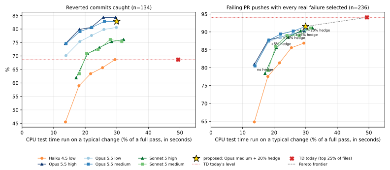

# LLM test selection for PyTorch CI: offline evaluation

**TL;DR.** We backtested picking each PR's tests with one Opus 5.5 call (medium effort, plus a 20% TD hedge) instead of today's target determination (TD). The result is mixed. The LLM policy catches more of the breakages that landed, but it is **below TD on failing PR pushes**. It would cut the spend of the test jobs in the Spend table (pull, trunk, inductor's unit tests, periodic and slow) **12%, from $855k to $750k a month** ($105k saved, $80k of it in the workflows this stack covers). It would also cut the p50 wait for pull and trunk from **181 to 169 minutes**. Fork PRs never get a selection, so both figures include them at today's cost and wait.

- **Reverted commits caught: 82.8% vs 68.7% for TD** (n=134). Each of these commits landed and was then reverted for breaking a test. "Caught" means its PR's CI would have gone red. The paired difference is +14.2 points, with a 95% bootstrap interval of +7.5 to +21.6 (22 caught only by new, 3 only by old; McNemar p<0.001).
- **Failing PR pushes with every real failure selected: 91.5% vs 94.1% for TD** (n=236 pushes from 148 PRs). Flaky failures are excluded. **The proposed config is 2.5 points below TD here.** The gap is not significant (95% interval -5.9 to +0.8 points resampling PRs; 6 pushes caught only by new, 12 only by old; McNemar p=0.24), but the point estimate is below TD, not level with it.
- **This truth favors TD by construction.** These PRs ran under TD, so the only failures we can see are in files TD chose to run (see What the backtest measures). Revert truth comes from main, where everything runs, so it is not censored this way.
- **Recommendation: keep the config and ship shadow mode only.** This stack ships `selection.ENFORCEMENT_ENABLED = False`, so even per-PR opt-in enforces nothing until it is flipped (Rollout step 2). Do not make enforcement the default (Rollout step 3) until the TD-off holdout shows live push recall at TD's level. The backtest cannot separate a real push-recall gap from the censoring bias, and only the holdout can.

| | Old: TD | New: Opus 5.5 medium + 20% hedge |
|---|---|---|
| Reverted commits caught (n=134) | 68.7% | **82.8%** |
| Failing PR pushes with every real failure selected (n=236) | **94.1%** | 91.5% |
| CPU / GPU test time run on a typical change | 49.4% / 45.9% | **30.0% / 33.6%** |
| Test-job spend | $855k/mo | **$750k/mo** |
| pull + trunk wait, p50 / p90 | 181 / 291 min | **169 / 262 min** |

- **The idea.** For each PR push, one `claude -p` call sees the title, the description, the diff, and every candidate test file annotated with its CI minutes. It returns the files worth running.
- **Old and new.**
  - "Old" is TD as it runs on PRs today: its top 25% of TestRuns per config, in the workflows that have TD.
  - "New" is the proposed production config: Opus 5.5 at medium effort, plus TD's top files up to 20% of each config's test time.
  - Main always runs everything in both.
- **The 25% and the 20% are in different units.**
  - TD's 25% counts TestRuns: run_test.py keeps the first `n * len // 100 + 1` of TD's ranked TestRuns, n = 25 when TD is on (`get_top_per_tests(percent_to_run)` in tools/testing/test_selections.py), whatever their size. A TestRun is a test file or a class-level part of one. TD ranks large, often-failing files high, so that quarter is 49.4% of the CPU test time on a typical change.
  - The hedge's 20% counts seconds: TD's ranked files are added in order until they fill 20% of the config's test time.
  - The model does not filter TD's list. New runs the union of the model's picks and the hedge:

| CPU test time run on a typical change | Share of a full pass |
|---|---|
| Old: TD's top 25% of TestRuns | 49.4% |
| New, model's picks alone (including the run-all rules) | 13.9% |
| New, model's picks plus the 20% hedge | 30.0% |

The hedge adds 16.1 points rather than 20. Files the model already picked are not charged to it, so on its own that would let it add the full 20. It adds less because the 19 run-all changes below already run everything and have nothing left to hedge, a file that does not fit the remaining budget is skipped, and only files with a positive TD score and a recorded time are hedged (`Selection.split` in selection.py).

- **Run-all.** 19 of the 187 typical changes (10.2%) run everything, nearly all through the test-infrastructure rule (CI scripts, docker images, commit pins, test workflows). Those 19 are 10.2 of the 13.9 points the model's picks run (73%), and 34% of new's CPU time with the hedge.
- **The model calls** cost about $0.5k a month at the recorded per-call cost. That figure leans on the prompt cache, and with a cold cache it is about $2.2k (see Dollar model). Either way it is small next to the saving.
- **Where the saving is.** This stack makes $80k of the saving reachable, in pull and trunk, once enforcement is the default (Rollout step 3). This stack ships shadow mode only: `selection.ENFORCEMENT_ENABLED` is False, so even PRs with the `ci-llm-selector` label save nothing until it is flipped (Rollout step 2). The other $25k is in workflows where TD is off today: inductor's unit tests, periodic and slow. Those run every test on PRs, so the selection is not enforced there, and inductor also needs a target-determination job first. See Follow-ups under Spend.
- **The stack.** The PRs below this one contain the selector, the harness, the run_test.py integration and a shadow-mode CI workflow. It ships shadow mode only: with `ENFORCEMENT_ENABLED` False every selection runs as shadow. Once that is flipped, enforcement is opt-in per PR through the `ci-llm-selector` label, and it applies only to same-repo PRs whose author is a member, owner or collaborator.

The sections up to Time to land compare only old and new. Other models, effort levels and hedge budgets are in [Sweep](#sweep-other-models-efforts-and-hedges), which is how the config was chosen.

## Proposed production config

| | Old | New |
|---|---|---|
| Selector | TD heuristics, top 25% per config | Opus 5.5, effort medium, no tools, plus TD's top files up to 20% of the config's test time |
| Safety rules | none | see Method: edited and added test files always run; files that already failed on the PR and that TD runs always run; changes to test infrastructure run everything; a missing or malformed answer is a selector failure, which keeps TD's split |
| Runs on | PRs in TD-enabled workflows | same-repo PRs by trusted authors in TD-enabled workflows; other PRs keep TD |
| Main pushes | everything | everything |

The backtest puts this config below TD on pushes. We have not changed the config to chase the push number. Larger hedges were not swept, and none of the swept models or efforts reaches TD on pushes at 20% (see Sweep).

## What the backtest measures

We took historical changes, asked each policy offline which test files it would run, and checked the answers against the tests that really failed. A failure is a (test file, CI config) pair, for example `test_ops.py` in the `default` config.

Only failures in jobs that run TD today count. Those are the workflows `td_enabled_workflow` accepts, pull, trunk, `rocm-*` and `periodic-rocm-*` (so not slow-rocm-mi200, inductor-rocm-*, inductor-perf-nightly-rocm-* or trunk-rocm-sandbox), minus the jobs where run_test.py turns TD off: macOS jobs, xpu and onnx builds, jobs with `force-no-td`, and the `dynamo_cpython` configs, whose `.ci/pytorch/test.sh` function sets `NO_TD=1`. Other jobs (inductor's unit tests, periodic, slow, ...) and the excluded ones run every test under both policies. Their failures cannot tell the two policies apart, so they are left out.

The two headline metrics are:

- **Reverted commits caught (n=134).**
  - These commits landed on main between 2026-04-01 and 2026-10-25, and the autorevert bot then reverted them because they broke tests.
  - Main runs every test, so we can see which files started failing, and in which configs, between the landing and the revert.
  - The truth is limited to the tests the autorevert bot cites as its signal (`source_signal_keys`, matched as (file, test name)). Other files that failed in that window are not counted.
  - 134 reverts broke a TD job, with 165 failures in those jobs. Reverts that broke only jobs without TD are not samples.
  - A revert is caught if the policy runs at least one of its failures, which is enough for the PR's CI to go red and block the land.
  - This truth is not biased toward either policy, since TD plays no part in what main runs.
- **Failing PR pushes with every real failure selected (n=236).**
  - We took the 149 PRs from 2026-10-01 to 2026-10-25 whose own CI failed tests that main did not fail, and every push (head commit) of those PRs, not just the first.
  - A push counts if one of its TD jobs had a test failure that is the PR's own by the rules below. 236 pushes of 148 PRs have such a failure among the scored candidates, 562 failures in all.
  - A push is caught only if the policy runs **every** one of its real failures, so the author sees the whole breakage in one round instead of finding the rest on the next push.
  - **Censoring.** These PRs ran under TD, so we only see failures in files TD chose to run. Old's replay is close to CI's own TD, so its recall here is near 100% by construction. It selects every failure on 94.1% of pushes, and on each PR's earliest failing push it catches 100% of the reproduced ones. New can match TD on this truth but can hardly beat it, so this metric favors old.

**Which PR failures are the PR's own.** A failing test on a PR head is dropped as flaky, or as not the PR's fault, by the first of these rules that applies (`History.why_dropped` in `build_dataset.py`). Like Dr.CI, the rules use hindsight, here within a 14-day window on either side. The counts are how many failing-test rows each rule dropped first, over 252 pushes of the PRs; 10,418 rows were kept, on 237 pushes:

| Rule | Dropped |
|---|---|
| the job does not run TD, or is unstable | 646 |
| the same test failed on main, on a branch with no known PR, or on another author's PR within 14 days, before this PR landed | 585 |
| the same test failed on a lower PR of the same stack, whose change this push's diff base already contains | 516 |
| the job passed on another attempt of the same head | 426 |
| the test passed again in the same job (run_test.py's rerun) | 45 |
| the failure is outside the window, or after the PR landed | 17 |
| the test was disabled within 14 days | 16 |
| the same test failed on main within 14 days of the push's merge base | 3 |

Reverts need no such filter: the autorevert bot already requires the failure to start at the reverted commit and persist.

**Test time run** is a mean over 187 random main commits from the 25 days to 2026-10-26, with reverted commits excluded. For each commit we take the share of a full CI pass's test-seconds a policy runs, counting CPU and GPU separately, over the configs that some TD job runs. The inductor unit-test configs are priced separately below. The dollars come from this number.

## Accuracy and test time

| | Old | New |
|---|---|---|
| **Reverted commits caught (n=134)** | 68.7% | **82.8%** |
| reverted commits with every failure selected | 66.4% | 82.1% |
| their failures caught (165) | 63.0% | 80.6% |
| **Failing PR pushes with every real failure selected (n=236)** | **94.1%** | 91.5% |
| failing PR pushes with at least one real failure selected | 98.7% | 97.0% |
| their failures caught (562) | 95.6% | 93.6% |
| CPU test time run on a typical change | 49.4% | 30.0% |
| GPU test time run on a typical change | 45.9% | 33.6% |
| Model call, $ per call / p50 latency | - | $0.041 recorded, $0.180 cold cache / 11s |

- **Reverts.** New catches 22 reverts that old misses, and old catches 3 that new misses (McNemar p<0.001; 95% interval of the difference +7.5 to +21.6 points).
- **Pushes.** New selects every real failure on 6 pushes where old does not, and old on 12 where new does not. The 95% interval is -5.9 to +0.8 points resampling PRs, and also -5.9 to +0.8 resampling pushes. The point estimate is below TD, and the interval allows at most a 0.8-point lead.
- **Without PR history.** On a variant of the head samples with the PR-history input removed (`previous_failures`, see Method), new drops to 89.0% and old to 93.6% (-4.7 points, 95% interval -10.1 to +0.4 resampling PRs). New relies more on the always-run-previous-failures rule than TD relies on its own PR-history heuristic.
- **Intervals.** They are a paired bootstrap (10,000 resamples) over reverts and over PRs; see Reproducing.
- **Optimism.** Old's numbers come from a replay of today's TD that is optimistic for it; see Caveats.

## Spend and savings

30-day runner cost of the test jobs the selection can shrink, from `misc.runner_cost`. Builds, lint and other non-test jobs are not counted. Neither are the test jobs that run every test under both policies, which the Time to land replay also keeps at r = 1 (`land_time.selectable`): the TD-off configs (docs_test, pr_time_benchmarks, dynamo_cpython and the like), macOS jobs, inductor's model benchmarks, and the inductor-workflow runs of the `inductor` unit-test config, which moved to trunk on 2026-10-06 (#199291) but kept running in inductor for PRs on older bases until mid-October. Those are about $5k a month in pull, $45k in trunk (macOS $23k, pr_time_benchmarks $22k) and $31k in inductor ($28k of benchmarks). Only the PR part of each workflow changes, meaning `pull_request` runs and `ciflow/` pushes; main, `release/*` and `landchecks/*` pushes and scheduled runs keep running everything.

**Fork PRs keep TD.** `llm-selector.yml` and the selection step in the `target-determination` job (`resolve_selection.py`) skip fork PRs, so their test jobs keep TD. Fork PRs are 36% of pull's PR test hours, 46% (CPU) and 47% (GPU) of trunk's, 30% and 32% of inductor's, and 37% of periodic's and of slow's. Each workflow's PR spend is cut to its same-repo share before the selection is applied, so fork-PR spend stays in both columns unchanged. PRs from the same repo whose author is not trusted (see Rollout) keep TD but are still counted. Pushing a branch to this repo needs write access, but anyone can open a PR from an existing branch (see `TRUSTED_AUTHORS` in resolve_selection.py), so how many such PRs there are was not measured.

| Workflow | Old $k/mo | New $k/mo |
|---|---|---|
| pull, CPU | 458.1 | 396.8 |
| trunk, CPU | 133.4 | 121.7 |
| trunk, GPU | 136.5 | 129.0 |
| inductor unit tests, CPU (follow-up) | 54.9 | 42.9 |
| inductor unit tests, GPU (follow-up) | 48.5 | 36.4 |
| periodic, GPU (follow-up) | 17.2 | 16.7 |
| slow, CPU (follow-up) | 6.2 | 6.1 |
| **total** | **855** | **750** |
| model calls | 0 | 0.5 (2.2 cold cache) |

- **Saved:** $105k a month, $85k CPU and $20k GPU. Dollar figures are rounded separately, so sums can be off by $1k. The first three rows, which this stack covers, are $80k, reachable once enforcement is the default (Rollout step 3).
- **Follow-ups.** TD runs, and so the selection is enforced, only when `GITHUB_WORKFLOW` is pull, trunk, `rocm-*` or `periodic-rocm-*`. That check lives in `td_enabled_workflow` in `tools/testing/target_determination/heuristics/utils.py`, which `--enable-td`'s default reads, and `TD_ENABLED` in `target_determination.yml` matches it. So jobs of the inductor unit-test workflow (run on PRs by `ciflow/inductor`), periodic (CUDA) and slow run every test, under old and new alike. The follow-up rows above assume each follow-up is done and the shadow data shows the selection is safe there. Inductor is worth $24k; periodic and slow $0.5k, since nearly all of their runs are scheduled or on release branches.
  - **Periodic and slow** already have a `target-determination` job, so their test jobs get TD's ranking and the selection. Each needs adding to `td_enabled_workflow` and to `TD_ENABLED`, which turns on TD's cut and the hedge with it.
  - **Inductor** has no `target-determination` job, in neither `inductor.yml` nor `inductor-unittest.yml`, so it gets no `td_results.json`.
    - Without that file, run_test.py turns TD off. Enforcement requires TD on, and the 20% hedge these rows assume needs TD's ranking.
    - The download step fails on the missing TD artifact before it reaches the selection.
    - Inductor first needs a `target-determination` job, then the same two changes.
- **Why 12% and not 40%.** New runs about 61% (CPU) and 73% (GPU) of the PR test time old does, but three things dilute that:
  - Fork PRs are about two fifths of PR test hours and keep TD.
  - Main and scheduled runs keep running everything.
  - The 20% fixed job overhead is not saved (see Dollar model).
- **Inductor.** Only the run_test.py unit-test configs are selectable, so the table counts only those jobs, 69% of inductor's CPU test-job cost and 89% of its GPU cost. The model benchmarks (huggingface, timm, torchbench) are $28k a month of the rest, mostly the CPU torchbench smoke test, and the moved `inductor` config $2k; neither is in the $855k.
- **Not in the table.** rocm-mi300 and the other ROCm workflows also download the selection, but `misc.runner_cost` carries their runners at $0, so they show up only under Time to land and Capacity. The remaining callers (win, mac, s390x, tpu) cost under $1k a month together or are also carried at $0. Two selectable buckets have no row either: periodic's CPU test jobs ($1.8k a month, 8% of their hours on PRs) and slow's GPU jobs, which `misc.runner_cost` also carries at $0; `dollars --constants` prints both.

## Time to land

Fork-PR runs keep TD, so their jobs are left unshrunk. The inductor rows assume the inductor follow-up (a `target-determination` job for inductor, see Spend); without it, inductor's part of the wait does not change.

| Wait for a PR push | Old (min) | New (min) |
|---|---|---|
| pull and trunk, p50 | 181 | 169 |
| pull and trunk, p90 | 291 | 262 |
| pull and trunk, mean | 205 | 183 |
| pull, trunk and inductor, p50 | 182 | 168 |
| pull, trunk and inductor, p90 | 299 | 272 |
| `@pytorchbot merge` that starts trunk, comment to merge, p50 | 186 | 179 |
| `@pytorchbot merge` that starts trunk, comment to merge, p90 | 269 | 259 |

If fork PRs were selected too, the pull and trunk wait would be 158 / 252 min (p50 / p90).

Time to signal (TTS) per workflow, in minutes:

| Workflow | Old p50 | New p50 | Old p90 | New p90 |
|---|---|---|---|---|
| pull | 70 | 53 | 95 | 88 |
| trunk | 182 | 174 | 277 | 263 |
| inductor (follow-up) | 136 | 123 | 223 | 214 |
| rocm-mi300 | 208 | 191 | 313 | 299 |

- **Merge wait.** 1,643 PR heads ran pull and `ciflow/trunk` together. On those, the p50 drops by 12 minutes and the p90 by 29. Trunk is the later signal for nearly all of them in both. 1,030 of them also ran `ciflow/inductor` within the same 10 minutes; inductor ends last on 15% of those (17% after), so trunk still bounds most of their wait.
- **Trunk is where the latency is.** Its long test shards are the critical path, so the test shrinkage shows up as wall-clock time. Trunk's p50 moves less than its mean (14 min saved on average): 46% of its PR test hours are fork PRs', which keep TD, and its macOS jobs run every test under both policies.
- **Pull leans toward build-bound.** Runs whose last job to finish is a build or another non-test job go from 12% to 22%. The floor is the xpu build (p50 40 / p90 49 min from creation to done) and the ROCm build (p50 23 / p90 53).
- **The model matches real merges.** When the merge comment started trunk (n=326), comment to merge took p50 186 / p90 269 min, against a measured (old) trunk TTS of 182 / 277 over every included trunk run. Taking each of those trunk runs' replayed saving off its merge gives the new 179 / 259. 11 more such merges are left out of both, since the replay left out their trunk run by the TTS rules in Method (a conclusion other than success or failure, a cancelled job, no test job, a TTS outside (0, 24 h], or created outside the window, such as in the last 12 hours). When trunk had already run before the comment (n=533), the merge took p50 3 min.
- **Two delays are not modelled, so the merge rows and the trunk saving are optimistic.**
  - The selection artifact is kept 3 days (`retention-days: 3` in llm-selector.yml), and resolve_selection.py treats an expired one as missing. A trunk run that a merge starts more than 3 days after the push gets no selection and keeps TD, and the p90 from first run to merge is 94.5 h.
  - Under enforcement the target-determination job waits up to `WAIT_SECONDS` (600 s) for a selector run that is still pending. The replay assumes the selection is ready.
- **CI is a minority of end-to-end time to land.** From the first pull run on the merged head to the merge is p50 15.8 h and p90 94.5 h, dominated by review. The saving matters most for authors iterating on red CI, since every push pays it again.

**Capacity.**
- PR test job-hours across pull, trunk, inductor and rocm-mi300 go from 675k to 545k over the included runs (about 29 days, see Method; cancelled runs and runs over 24 h are left out). That includes inductor's unit tests, which need the inductor follow-up. `Test` is 70-95% of test-job time on every major runner type.
- Median runner queues are already 1-3 minutes, but the tails are long: a10g p90 14 min, l4 p90 11, macos-m1 p90 59, mi300 p90 55, and the 4-GPU a10g pool p50 10 / p90 132. Freed capacity should cut those tails; this is a qualitative argument, not a model.

**Method.**
- **Replay.** For every PR workflow run in the 30 days to 2026-11-03, each same-repo test job's `Test` step is shrunk by the ratio r of new to old test time for that job.
  - Each job keeps its start time. Builds and non-test jobs are unchanged, shards are not rebalanced, and queueing effects are ignored.
  - A run is a fork PR's when its head repository is not pytorch/pytorch or is unknown (conservative: the run keeps today's time). For `ciflow/` pushes, the PR's head repository decides. Fork runs keep r = 1. This month's cache has a head repository for every PR run, so none is unknown.
  - Jobs that run every test under both policies keep r = 1 too (`land_time.selectable`). Configs whose test.sh branch never runs run_test.py (`land_time.NO_RUN_TEST`: docs_test, backwards_compat, libtorch_agnostic_targetting and the like) are dropped first. The rest are classified by job name with `score.job_runs_td`, the rule the truth uses, which keeps r = 1 for test.sh's NO_TD dynamo_cpython configs and the macOS and xpu jobs.
- **The ratio r.**
  - In pull, trunk and rocm-mi300, r is 0.606 (CPU) and 0.732 (GPU), from the unrounded typical-change test-time shares.
  - In inductor, which has no TD, r is 0.498 / 0.403 for the unit-test configs (assuming the inductor follow-up) and 1 for the model benchmarks and the other configs `land_time.inductor_unit_configs` leaves out, such as the moved `inductor` config (see Spend).
  - r is one ratio per workflow and runner kind, applied to every shard. An unbalanced selection, where one shard keeps most of the selected tests, would make the real latency win smaller.
- **TTS** is the last job's completion minus the run's creation. Only first attempts are used, from runs created between 29.5 days and 12 hours before the end. Runs whose conclusion is not success or failure, runs with a cancelled job, runs with no test job and runs whose TTS is not in (0, 24 h] are excluded.

## Dollar model

- **Overhead.** The selectable part of each test job is the Test step. Outside it, checkout, docker pull, build download and teardown take a median of 4.3 to 4.8 minutes, about 12-15% of the job. The model assumes a fixed overhead fraction of 0.2 for that.
- **Relative cost.** A job's relative cost is `0.2 + 0.8 * f`, where f is the share of test time it runs. For old, f is the replayed TD share in TD workflows and 1 elsewhere. The same-repo PR share of each workflow's test spend is then rescaled by new over old.
- **Test-time shares.**
  - pull and trunk use the typical-change shares from the Accuracy table: old 49.4% CPU / 45.9% GPU, new 30.0% / 33.6%.
  - periodic and slow have TD off today, so old runs everything there (relative cost 1) and new uses the same new shares. Those shares are over the configs TD jobs run, so the periodic and slow rows are approximations ($0.5k together).
  - The inductor rows use the configs of inductor-unittest.yml that no TD job runs (`land_time.inductor_unit_configs`, the set the Time to land replay shrinks), over only the 67 of 187 typical commits that match the `ciflow/inductor` labeler globs, since those are the PRs that run it. On those, new runs 49.8% of CPU and 40.3% of GPU unit-test time; old runs everything. trunk's own `inductor` config has TD and is priced with trunk.
- **Model cost.**
  - $0.041 per call is the mean recorded cost over the 425 eval samples the selector asks the model about (`dollars.mean_call_usd`). At 12.2k same-repo PR pushes a month that is $0.5k a month. Fork PRs make no call. That is an upper bound: pushes whose changes run everything make no call either (45 of the 470 samples), so the real figure is about 10% lower.
  - **That figure depends on the prompt cache.** The Opus medium and high runs ran after Opus low on the same prompts and read 92-93% of their input from cache. Opus low, run first, read 12%.
  - Priced cold, with every cache read billed as a cache write at the fitted rates ($4 input, $5 cache write, $0.20 cache read, $20 output per Mtok), every Opus effort costs $0.17-0.19 per call, over the calls made in one attempt with their usage recorded (all 425 here). The second Opus medium run, which hit a cold cache, recorded $0.146-0.164 per call.
  - `dollars --cold` prints the cold $/call and the fitted rates (`dollars.cold_call_usd`, a least-squares fit of the recorded cost to the four token counts). The fitted rates per Mtok (input / cache write / cache read / output) are $4 / $5 / $0.20 / $20 for Opus, $2 / $2.50 / $0.20 / $10 for Sonnet and $1 / $1.25 / $0.10 / $5 for Haiku.
  - A cold-cache bound is about $0.18 x 12.2k = $2.2k a month. In CI each PR push sends a different diff, but the long candidate list is a shared prefix, so the real figure is somewhere between the two.
  - Timed-out calls record only their earlier attempts' cost, so they are left out of the mean.

The overhead fraction dominates the uncertainty:

| Overhead | CPU saved | GPU saved | Total saved | This stack |
|---|---|---|---|---|
| 0.1 | $103k | $24k | $127k/mo | $99k |
| **0.2** | **$85k** | **$20k** | **$105k/mo** | **$80k** |
| 0.35 | $62k | $16k | $78k/mo | $58k |
| 0.5 | $44k | $12k | $55k/mo | $40k |

**Where the GPU money is.**
- The GPU number is smaller because GPU jobs are under a quarter of the selectable spend ($202k of $855k), and new keeps more of the GPU test time old runs (73%, against 61% on CPU).
- The inductor model benchmarks ($28k a month) are not selectable test files, but the same approach could gate them: ask the model whether a change can affect compiled-model performance or accuracy at all. That is a yes/no question rather than a file list, and it is step 5 of the rollout.
- Skipping shards whose selection is empty would also recover the job overhead the model treats as fixed.

## Method

**Unit of selection.**
- The unit is a test file under `test/`. Selecting a file runs it in every config it belongs to: default, distributed, slow, inductor and so on.
- The two wrapper sweeps, `dynamo_wrapped` and `crossref`, re-run hundreds of ordinary files in a special mode. The model requests them separately; an unrequested sweep runs only the selected files.
- The model can also request whole directories (`dynamo`, `inductor`, ...) or `run_all`.

**Safety rules.** `Selection.from_model_output`, `select_tests.py` and `apply_selection` apply these on top of the model's answer:
- **Always selected.**
  - A test file the PR edits or adds.
  - The test files that import an edited test file.
  - Every test file the model was not shown.
  - Configs that compile every test (`run_test.py --inductor`) always run the files `ALWAYS_COVERED` lists. `inductor` always runs test_modules, test_ops, test_ops_gradients and test_torch; `inductor_cpp_wrapper` always runs test_torch.
- **Enforced run-all.** The answer becomes run-all when:
  - no file changed, or more than `MAX_CHANGED_FILES` (1000) did;
  - the change touches anything that decides how tests run (`RUN_ALL_PATTERNS`): run_test.py, conftest, common_utils, common_device_type, tools/testing, the test shell scripts and actions, the CI docker images and commit pins;
  - an edited inductor failure list names an unknown test class;
  - more than `MAX_DATA_FILES` (50) edited non-test files under `test/` would need their readers found one by one;
  - test modules import the change through `MAX_IMPORT_HOPS` (8) or more hops;
  - nothing is found that reads an edited data file under `test/`.
- **Selector failures.** A missing or malformed answer, or any other selector error, is marked not enforced, and CI keeps TD's own split. The harness's `final+tdN` policies score it the same way, as TD's top 25%; `model`, `final` and `final-hm` score it as run-all.
- **Fallbacks in run_test.py.** `apply_selection` keeps TD's split when there are no test times, when the PR's previous failures were not recorded, or when the selection chose no files for the job.
- **Previous failures.** Under enforcement, run_test.py also always runs the files that already failed on the PR and that TD's split runs, whatever their size and outside the hedge budget. Other previous failures compete for the hedge like any TD-scored file. The harness models this with each head sample's `previous_failures`: the files with a test that failed, and did not pass again, in a TD job on an earlier push of the PR. 110 of the 237 head samples have some.

**Hedge.** The hedge adds TD's highest-ranked files with a positive score until they fill 20% of the config's test time, charging each file once. A file that does not fit is skipped and filling continues.

The harness applies the same fill rule, per config, summed over build environments rather than per job. CI fills 20% of one job's own test list (all its shards together) from that job's test times. CI also applies the cut and the hedge per run_test.py call, while the harness pools a config's calls into one list. Modelling inductor's calls separately moves no failure, and moves the mean cost shares by under 0.6 points, except TD's GPU share on the eval set (-2 points).

**Cost.**
- Cost is the share of one full CI pass's test-seconds that a selection runs, per config, from `test-times.json`. Configs that no TD job runs are left out; the inductor unit-test ones are priced separately.
- Jobs are classified from `.github/workflows`, trying in order:
  - name and config;
  - name and config with CUDA and Python versions wildcarded, since CI has moved to newer ones since the oldest reverts;
  - config alone.
- A reusable workflow's jobs take their caller's TD setting. So `dynamo-unittest` jobs (called from trunk) have TD, and `unit-test / ...` jobs (called from inductor) do not.
- A TD workflow is one `td_enabled_workflow` accepts: pull, trunk, `rocm-*` and `periodic-rocm-*`. slow-rocm-mi200, inductor-rocm-*, inductor-perf-nightly-rocm-* and trunk-rocm-sandbox are not.
- Within a TD workflow, jobs that run_test.py runs without TD are classified as non-TD, as in CI: `_mac-test.yml` jobs, xpu and onnx build environments, jobs with `force-no-td`, and the `dynamo_cpython` configs (`NO_TD=1` in `.ci/pytorch/test.sh`, `NO_TD_CONFIGS` in score.py).
- `test-times.json` is merged over jobs per config, so a config that TD and non-TD jobs share, like `default` in periodic, is priced as one.
- Seconds are summed over every build environment. Environments matching `cuda|rocm|sm\d+|h100|b200|a100|gpu` count as GPU.

**Dataset** (`eval/build_dataset.py`, ClickHouse plus git). There are four kinds of sample:

| Kind | Reported n | Window | Truth |
|---|---|---|---|
| revert | 134 | 2026-04-01 to 10-25 | Main commits the autorevert system reverted. The truth is the failures of the autorevert signal's tests (`source_signal_keys`) in main TD jobs between landing and the revert, with their configs. |
| pr | 149 | 2026-10-01 to 10-25 | The PR's earliest failing push whose failures are the PR's own by the rules above. It defines which PRs `head` covers, and backs the first-push rows in Sweep. |
| head | 237 | pushes of the `pr` samples' PRs | Every push of a `pr` sample's PR with a failure that is the PR's own; the truth is those failures. 236 have a failure among the scored candidates. |
| neutral | 187 | 2026-10-01 to 10-25 | Random main commits ("typical changes"), with no truth. They measure how much a selector runs on a typical change, which is what the dollars depend on. |

- **Censoring.** Reverts are the least biased sample. On PRs in TD-enabled workflows we only ever observe failures in the files TD already chose to run, so PR truth is censored toward TD's picks. Main runs everything, so revert truth is not censored this way.
- **Diff base.** Each sample is diffed the way `select_tests` diffs it in CI.
  - PR and head samples use the base CI passed to the selector for that head (for a ghstack PR, the PR below it), read from the head's pull_request runs.
  - When no run recorded a base, the sample falls back to its merge base with main. That happens for 71 of the 149 PR samples and 102 of the 237 heads.
  - Revert and neutral samples are diffed against their parent commit.
- **Commit text.** PR and head samples carry the PR's title and body as of the build. Revert and neutral samples carry the landed commit message, with the merge bot's additions stripped: the " (#N)" suffix, ghstack dependencies and Stack dependencies lines.

**Prompt development.**
- The prompt (`prompt.md`) was iterated on a disjoint 430-sample dev set (`eval/ids/dev.txt`).
- The neutral pilot samples that were looked at while writing it are excluded from the reported set.
- The reported set is `eval/ids/eval.txt`: 134 reverts, 149 first-push PRs and 187 typical changes. Its neutral part is `eval/ids/neutral.txt`, and the pushes are in `eval/ids/head.txt`.
- Every model ran the same prompt on the same samples, with no tools. Mean input was about 31k tokens for Opus; the candidate list is about 1,100 files.

**TD baseline.**
- `eval/td_replay.py` runs today's in-repo TD heuristics on each sample, with the changed files, the commit text and the head sample's `previous_failures` patched in. It then takes the top-25% cut CI uses, per config.
- The heuristics read today's historical-stats artifacts, which already contain these failures. The replay is therefore optimistic for TD.

## Sweep: other models, efforts and hedges

This section is how the production config was chosen. Rows use the same samples and definitions as [What the backtest measures](#what-the-backtest-measures).



How to read the chart:
- Each line is one model and effort level, through hedge budgets of 0, 5, 10, 15 and 20% (labeled on the Opus medium line of the failing-pushes panel).
- The red X is today's TD, and the dotted red line marks its level.
- The gold star is the proposed config.
- The dashed gray line is the Pareto frontier: no point beats a frontier point on both axes.
- The x axis is the CPU test time run on a typical change, which is what the dollars scale with.

**Opus 5.5 at each effort and hedge:**

| Effort / hedge | Reverts caught | Reverts, every failure | Pushes, every failure | Pushes, any failure | Typical CPU | Typical GPU |
|---|---|---|---|---|---|---|
| low, 0% | 70.1% | 68.7% | 80.5% | 90.3% | 13.9% | 19.8% |
| low, 5% | 75.4% | 73.9% | 87.3% | 95.3% | 18.3% | 24.4% |
| low, 10% | 77.6% | 75.4% | 88.6% | 96.2% | 22.0% | 27.7% |
| low, 15% | 79.9% | 77.6% | 89.4% | 96.6% | 25.9% | 30.6% |
| low, 20% | 80.6% | 78.4% | 90.7% | 97.0% | 29.9% | 33.2% |
| medium, 0% | 74.6% | 73.9% | 80.5% | 90.3% | 13.9% | 20.1% |
| medium, 5% | 79.1% | 78.4% | 87.7% | 95.8% | 18.3% | 24.7% |
| medium, 10% | 80.6% | 79.9% | 89.4% | 96.6% | 22.1% | 28.1% |
| medium, 15% | 82.8% | 82.1% | 90.3% | 97.0% | 26.1% | 30.8% |
| **medium, 20% (production)** | **82.8%** | **82.1%** | **91.5%** | **97.0%** | **30.0%** | **33.6%** |
| high, 0% | 74.6% | 73.1% | 80.9% | 90.3% | 13.7% | 19.8% |
| high, 5% | 79.9% | 78.4% | 87.7% | 95.8% | 18.1% | 24.4% |
| high, 10% | 80.6% | 79.1% | 88.6% | 96.2% | 21.9% | 27.8% |
| high, 15% | 84.3% | 82.8% | 89.4% | 96.6% | 25.7% | 30.7% |
| high, 20% | 84.3% | 82.8% | 90.3% | 97.0% | 29.7% | 33.3% |
| TD today (old), for reference | 68.7% | 66.4% | 94.1% | 98.7% | 49.4% | 45.9% |

Saved per month at the 0.2 overhead, for Opus medium: $181k with no hedge, $160k at 5%, $142k at 10%, $124k at 15% and $105k at 20%.

**Other models, 20% hedge.** $/call is the mean recorded cost over the 425 eval samples the model is asked about. Cold is the same calls with every cache read priced as a cache write (`dollars --cold`); for every model all 425 were single-attempt calls with their usage recorded, so both columns cover the same 425. p50 wall is the model call alone.

| Model / effort | Reverts caught | Pushes, every failure | Typical CPU | $/call | $/call, cold | p50 wall |
|---|---|---|---|---|---|---|
| **Opus 5.5 medium (production)** | **82.8%** | **91.5%** | **30.0%** | **$0.041** | **$0.180** | **11s** |
| Opus 5.5 low | 80.6% | 90.7% | 29.9% | $0.153 | $0.170 | 6s |
| Opus 5.5 high | 84.3% | 90.3% | 29.7% | $0.048 | $0.188 | 14s |
| Sonnet 5 medium | 75.4% | 91.1% | 31.6% | $0.101 | $0.154 | 8s |
| Sonnet 5 high | 76.1% | 91.1% | 32.2% | $0.104 | $0.127 | 15s |
| Haiku 4.5 low | 68.7% | 86.9% | 29.4% | $0.057 | $0.057 | 28s |

**What the sweep shows.**
- **No swept config reaches TD on pushes.**
  - Without a hedge, every Opus effort is ahead of TD on reverts (70.1-74.6% vs 68.7%) at under a third of its CPU test time. But it selects every real failure on only about 81% of failing pushes, against TD's 94.1%.
  - The hedge closes most of that gap, since TD's heuristics rank recently failing tests high and many PR failures are in those. At 20%, Opus medium is still 2.5 points under TD (95% interval -5.9 to +0.8, resampling PRs as everywhere in Sweep), low 3.4 under (-6.9 to 0.0) and high 3.8 under (-7.4 to -0.4).
  - Part of this is the censoring above, but how much cannot be measured offline.
  - Budgets above 20% were not swept. Each 5 points of hedge costs about $19k a month of the saving.
- **Why medium effort.** At the 20% hedge, low, medium and high are within 3.7 points of each other on reverts and 1.3 on pushes. The push spread is well inside the bootstrap intervals; the revert spread is above the 1-2 points measured run to run (see below), so effort may matter on reverts. Only high is significantly below TD on pushes at the 95% level (-7.4 to -0.4); low's interval reaches 0.0 and medium's +0.8, so that does not separate low from medium. Medium was kept as the middle setting, ahead of low on both metrics (82.8% vs 80.6% on reverts, 91.5% vs 90.7% on pushes), though both gaps are within the noise. Its p50 is 5s slower than low's, which is negligible next to the test jobs.
- **Model size matters more than effort.**
  - Opus at any effort beats Sonnet on reverts by 4-9 points at the 20% hedge. On pushes the two are level.
  - Haiku 4.5 does not support the effort setting, so its `low` label is nominal (select_tests.py always passes `--effort`, here `low`). It is well behind on both metrics.
  - Sonnet sometimes fails to produce schema-valid output after retries: 25 of 237 pushes at medium effort and 12 at high. Those are selector failures, which keep TD's split.
- **Spend goes on run-all and the hedge.**
  - The run-all rules fire on 19 of the 187 typical changes. 17 of those are test-infrastructure changes (`.ci/pytorch/test.sh` and `common.sh`, the docker images and commit pins, the test workflows, common_utils), which `select_tests` runs in full without asking the model. The 19 run-all changes account for 10.2 of the 13.9 points of CPU time the no-hedge policy runs. The hedge adds the rest.
  - Narrowing those rules, in particular the commit-pin bumps, is the cheapest remaining lever. They were kept broad because several reverts are docker image changes.
- **The LLM and TD miss different things.** On reverts, Opus medium with no hedge catches 23 that TD misses, and TD catches 15 that Opus misses. Their union catches 115 of 134 (86%). This is why the hedge works.
- **Run-to-run variance is about 1-2 points on reverts.**
  - A second identical Opus medium run gives 82.1% of reverts with the 20% hedge (vs 82.8%) at 29.8% CPU.
  - Two Opus low runs give 70.1% and 70.9% with no hedge, and 80.6% and 82.1% with it.
  - The second runs were scored separately, on the eval samples only (not the pushes), so run-to-run variance on the push metric is not measured. The bootstrap intervals above cover sampling noise only.
- **The budgets are not nested.** The hedge skips a file that does not fit and keeps filling, so a larger budget can take one large file in place of several small ones. A larger budget therefore does not always catch more.

**First-push PR metrics.** For reference, Opus medium with the 20% hedge against TD on each PR's earliest failing push:
- PRs with any failure that is the PR's own (n=148): 96.6% vs 99.3%.
- PRs with a failure that reproduced in two build environments or on two pushes (n=118): 97.5% vs 100%.
- The push metric above replaces both. It counts every push, and it excludes flakes by the rules above rather than by requiring a second occurrence. Requiring reproduction drops real failures too: a one-off is often a real bug that only one environment runs, or that the author fixed in the next push.

**Revert misses.** Opus high with no hedge misses every failure on 34 of the 134 reverts. The AI assistant that wrote this stack hand-checked the misses on an earlier version of the revert truth and scoring; a human has not reviewed them.
- About a quarter are not plausibly caused by the reverted commit; they are label noise. Examples:
  - a torchtitan pin bump labeled with a test_testing failure;
  - a docs change labeled with libtorch_agnostic;
  - a shard propagation change labeled with test_max_autotune;
  - a `gc.collect` change labeled with a torch_np dtype test.
- The real misses are mostly generic sweeps. Examples:
  - an OpInfo edit that broke functorch/test_ops;
  - a gradcheck change that broke test_ops;
  - docker image changes, now covered by the run-all rule.
- The prompt already calls these out, and they are the next target for prompt iteration. The TD-off holdout, and enforced PRs that are later reverted on main, will show whether they happen in practice (see Rollout).

**Agentic mode.**
- **Setup.** Sonnet 5 medium was rerun on 120 of the samples (39 PR, 52 revert, 29 neutral) with Read/Grep/Glob over a checkout of the change.
- **It did not help.**
  - Reverts: 28 of the subset's 52 scored reverts were caught with tools (53.8%), against 32 without (61.5%).
  - PRs: 30 of the 31 scored PRs with tools (96.8%), against 29 without (93.5%).
- **Cost and latency were about the same.** Per call it cost $0.100-0.112 against $0.108-0.118 without tools, and p50/p90 latency was 8s/20s against 10s/31s.
- **Opus without tools is better.** On the same subset, Opus 5.5 low with no tools catches 35 of the 52 reverts (67.3%) and 30 of the 31 PRs.
- **Conclusion.** Spend on a bigger model, not on letting a smaller one explore. CI runs with `--tools ""`, which also removes any route for PR content to drive file reads.

## Caveats

- **The push truth is censored toward TD, and the TD replay is optimistic.**
  - The replay uses today's heuristic stats, which include these failures.
  - PR truth only contains failures in files TD chose to run.
  - Both favor old, so new being 2.5 points below TD on pushes is an upper bound on the true gap, but how loose a bound is unknown.
  - Failures in jobs without TD (inductor unit tests, periodic, slow, ...) are left out, because both policies run everything there.
- **The PR truth window had not closed.**
  - The flaky rules look for another author's failures, and for disabled tests, up to 14 days after `--end`, which is 2026-11-09 for the reported PR samples.
  - The samples were built on 2026-11-03, so a few later sightings that would have dropped a failure as flaky are missing, and the push truth may keep a few flakes.
  - `build_dataset.py` refuses to build PR and head samples before the window closes, and it records the window in each PR sample. The reported samples predate that check and should be rebuilt after 2026-11-09.
- **The flaky rules are approximations.**
  - A failure is matched by test, within 14 days on either side.
  - A real failure that another author also hit, such as two PRs breaking the same test, is counted as flaky. So is one on a stack split across authors.
  - In the reported samples the author's own lower PRs in a stack count at any age, since ghstack lower PRs can sit for weeks. `build_dataset.py` now counts them only until they land, and only on jobs the other rules keep, so the rebuild after 2026-11-09 will differ here.
  - A flaky test that failed only on this PR is counted as real.
- **Revert truth.** It is the autorevert signal's (file, test name) keys; the reported samples ignore the test class, which `build_dataset.py` now matches when the signal key has one. The bot requires the failure to persist, so the truth is not filtered further for disabled tests or failures elsewhere.
- **Renames.** The TD replay gives every heuristic the sample's `--no-renames` changed-file list, which lists a moved file at both paths; CI's TD sees only the new path. 21 of the 1137 samples contain a pure rename (7 of the 470 eval ids, 1 of the 237 head ids), so old's numbers on those few samples come from a slightly different input than CI's.
- **Label noise.** About a quarter of the remaining revert misses look unrelated to the reverted change, so true revert recall is higher than reported.
- **Commit text can leak the outcome.** PR bodies are read as of the build, after any edits made once CI failed. The cc lines and any remaining merge-bot text in landed messages can also hint at the kind of change.
- **Training-data contamination.** Reverts before mid-2026 may predate the models' knowledge cutoff. The PR samples (October 2026) do not, and they show the same ordering of models.
- **Prompt injection.**
  - A PR's description or diff can try to talk the model into selecting nothing.
  - **Mitigations.**
    - Enforcement is off in this stack (`ENFORCEMENT_ENABLED` False). Once it is flipped, it is opt-in per PR through the `ci-llm-selector` label, which is read live when the workflow run resolves the selection.
    - The selector workflow runs only for same-repo PRs. It runs from the default branch's copy of the workflow and code: since GitHub's 2025-12-08 change, `pull_request_target` always uses the default branch, whatever the PR's base.
    - The selector reads the diff through git, and the title and description from the event payload (`GITHUB_EVENT_PATH`). It never runs PR code.
    - Main always runs everything.
  - The worst case is the same as a TD miss today: the regression is caught on main and reverted.
- **Diff base.** 71 of the PR samples and 102 of the head samples had no recorded CI base and are diffed against their merge base with main. For a stacked PR, that shows the model the whole stack below it, a larger diff than CI shows.
- **Deployment noise.** The CI workflow uses the existing `bedrock` environment. Its latency and throttling there are not measured here; the shadow selection metric will measure them.

## Rollout

1. **Shadow (this stack).**
   - **The selector.** `llm-selector.yml`, a `pull_request_target` workflow that runs on `opened`, `synchronize` and `reopened`, writes a selection for every same-repo PR push. The selection is the artifact `llm_selection_<PR number>_<head sha>`, kept for 3 days.
   - **Resolving it.** The workflow run's `target-determination` job resolves the selection once (`resolve_selection.py`) and uploads it as `llm_selection.json`. The test jobs' download-td-artifacts step only downloads that file from their own workflow run.
   - **Provenance.** `selector_runs` in `resolve_selection.py` only filters runs: it takes the artifact named for this PR and head only from an `llm-selector.yml` `pull_request_target` run for that head whose head branch is in this repository. `main()` decides enforcement. It requires all of these:
     - `ENFORCEMENT_ENABLED` in selection.py, False in this stack;
     - TD on in the workflow (`TD_ENABLED`);
     - an author whose `author_association` is OWNER, MEMBER or COLLABORATOR;
     - the PR's live labels: `ci-llm-selector` present and `ci-no-td` absent.
   - **Waiting.** When enforcing, `resolve_selection.py` waits up to `WAIT_SECONDS` (600 s) for a pending selector run of the head. Otherwise it uses the newest successful run's selection, in shadow.
   - **Failures.** The artifact's own `enforce` flag can only turn enforcement off, so a planted or stale artifact cannot enforce a selection on a PR without the label. A selector failure, or a missing or malformed artifact, keeps TD's split.
   - **Logging.** run_test.py logs:
     - `llm_selection`: what the selection would run, and its time;
     - `llm_selection_failure`: each failing test, with whether the model's picks covered it, whether the hedge or the previously-failed rule did, and whether it was in TD's include list.
   - **What the shadow failure metric does not measure.** With TD on, only TD's include list runs, so the shadow metric only sees failures in files TD picked. It compares the selection with TD, not with the truth. Under enforcement only the selected, hedged and previously failed files run, so every observed failure is covered by construction.
   - **Where live recall comes from.**
     - The `td-holdout-unstable` workflow runs with TD off. It covers the `default` and `distributed` configs of the linux-jammy-py3.11-gcc11 build and the `dynamo_wrapped` config of the clang21 build, all CPU, without `inductor/test_torchinductor_opinfo` (`tests-to-exclude`). Its rows, with `td_enabled` false, see every failure in those configs.
     - It runs only when a PR is `opened`, and a shadow resolve only uses a selector run that has already succeeded. So a holdout row often has no selection yet, and the rows that have one lean toward PRs whose selector finished before the holdout's target-determination job.
     - Enforced PRs that later break main are the other source, since main runs everything.
   - **Gate for step 3.** Wait for a few weeks of the holdout's recall, for the PRs that do have a selection, to be at least TD's on the same configs. Also wait for the selection's run time to match the typical-change shares.
     - **TD's recall there.** The holdout sets `force-no-td`, so TD's include list is every file and `llm_selection_failure`'s `in_td_include` is always true on its rows. TD's recall is instead recomputed from the same failures' `td_test_failure_stats_v2` rows, which run_test.py emits with TD's ranking even with TD off: a failure counts for TD if its `position` is below `len(all_scores) * 25 // 100 + 1`. That is the cut `get_top_per_tests(25)` makes in `split_tests` (`tools/testing/test_selections.py`, called from run_test.py with TD on): `position` and the include list both index `TestPrioritizations._traverse_scores()` (`heuristics/interface.py`), and `all_scores` has one entry per TestRun in it.
     - **Previous failures differ from enforcement.** With every file in TD's include list, the selection's previously-failed rule admits every file that already failed on the PR. Under enforcement it admits only those in TD's top 25%, and the rest compete for the hedge. So a holdout failure covered only by `previous_failure_added` counts for the selection only if the file is in TD's recomputed 25%. Without that correction the holdout's recall would be optimistic against enforcement. **Given the backtest's push result, this gate is the decision point, not a formality.**
2. **Opt-in enforcement.** `ci-llm-selector` enforces the selection, with the 20% hedge, on that PR. This also needs `ENFORCEMENT_ENABLED` in selection.py flipped to True, once the HUD and test-infra consumers handle `llm_selection_exclusions` and `llm_enforced`; while it is False, an enforced selection runs as shadow.
3. **Default enforcement.** Enforce on every same-repo PR from a trusted author, with `ci-no-td` as the opt-out. This unlocks about $80k a month and the merge-wait drop above. Track reverts of enforced PRs on main as the live check of revert recall. Only take this step if the holdout clears the gate in step 1; if it does not, raise the hedge or iterate the prompt first.
4. **Inductor, periodic and slow.**
   - Periodic (CUDA) and slow already have a `target-determination` job. Add them to `td_enabled_workflow` in `tools/testing/target_determination/heuristics/utils.py` and to `TD_ENABLED` in `target_determination.yml`, which turns TD on for them.
   - Inductor first needs a `target-determination` job in `inductor.yml`, then the same two changes. Without TD's ranking there is no TD to enforce over and no hedge.
   - Inductor's unit tests are worth about $24k a month; periodic and slow about $0.5k.
5. **Benchmarks and shards.** Gate the inductor model benchmarks on a yes/no model answer, and skip shards with nothing selected.

**Future work: a persistent per-test summary.** Each call re-reads the candidate list with nothing but file names and CI minutes. A summary per test file could record what the file exercises and which source areas have broken it before. Generated once and refreshed as tests change, it would give the model the knowledge TD's heuristics encode, and could let the hedge shrink.

## Reproducing

The reported PR and neutral samples come from 2026-10-01 to 2026-10-25, and the reverts from a wider window starting 2026-04-01. build_dataset therefore runs three times into the same, fresh `$DATA`:
- `--end` is exclusive, and `head` needs the `pr` samples.
- PR and head builds refuse to run until `--end` plus 14 days has passed.
- The sample ids the report is scored on are checked in under `eval/ids/`. A fresh build will not match them exactly, since ClickHouse and main keep moving.

**Samples, test times and the TD replay.**
- `run_eval`, `td_replay`, `score` and `dollars` read the per-config test times from `$DATA/test-times.json`.
- `td_replay` reads TD's historical-stats artifacts from `.additional_ci_files`.
- Both are what CI downloads from test-infra's `generated-stats` branch. The report's snapshot is not checked in, so a fresh download has today's stats.

```
python -m tools.testing.llm_selector.eval.build_dataset --data $DATA --start 2026-10-01 --end 2026-10-26 --kinds pr neutral
python -m tools.testing.llm_selector.eval.build_dataset --data $DATA --start 2026-10-01 --end 2026-10-26 --kinds head
python -m tools.testing.llm_selector.eval.build_dataset --data $DATA --start 2026-04-01 --end 2026-10-26 --kinds revert
python -c "from tools.stats import import_test_stats as s; [f() for f in (s.get_test_times, s.get_test_class_times, s.get_test_file_ratings, s.get_test_class_ratings, s.get_td_heuristic_historial_edited_files_json, s.get_td_heuristic_profiling_json)]"
cp .additional_ci_files/test-times.json $DATA/
python -m tools.testing.llm_selector.eval.td_replay --data $DATA
```

**Model runs**, one tag per Sweep row. Results are cached per sample, so a rerun only runs the ids without a result file; errors and timeouts are kept unless their files are deleted. Each result records its prompt's hash: run_eval refuses a tag whose results came from another prompt or sample, and score leaves such samples out:

```
IDS=tools/testing/llm_selector/eval/ids
cat $IDS/eval.txt $IDS/head.txt > all.txt
OPUS=us.anthropic.claude-opus-5-5 SONNET=us.anthropic.claude-sonnet-5 HAIKU=us.anthropic.claude-haiku-4-5-20251001-v1:0
run() { python -m tools.testing.llm_selector.eval.run_eval --data $DATA --tag $1 --model $2 --effort $3 --ids ${4:-all.txt} $5; }
run v3_opus55_low $OPUS low; run v3_opus55_medium $OPUS medium; run v3_opus55_high $OPUS high
run v3_sonnet5_medium $SONNET medium; run v3_sonnet5_high $SONNET high; run v3_haiku45_low $HAIKU low
run v3_opus55_medium_r2 $OPUS medium $IDS/eval.txt; run v3_opus55_low_r2 $OPUS low $IDS/eval.txt
LLM_SELECTOR_AGENTIC_SANDBOX=1 run v3_sonnet5_medium_agentic $SONNET medium $IDS/agentic.txt --agentic
```

`--agentic` gives the model Read, Grep and Glob over the checkout on untrusted PR text, so run_eval refuses it without `LLM_SELECTOR_AGENTIC_SANDBOX=1`: set that only in a sandbox whose only secret is the model credential.

The order matters for the recorded $/call: runs that share a prompt prefix with an earlier run read it from cache (see Dollar model).

**Scoring, chart, intervals and dollars.**
- The eval ids give the revert, first-push PR and typical-change rows.
- The head ids give the failing-push rows.
- `--all-truth` gives the first-push "any failure" row.
- The `_r2` runs are scored on their own.
- The chart was rendered with matplotlib 3.11.1.

```
S="python -m tools.testing.llm_selector.eval.score --data $DATA"
TAGS="v3_haiku45_low v3_sonnet5_medium v3_sonnet5_high v3_opus55_low v3_opus55_medium v3_opus55_high td"
H=final,final+td5,final+td10,final+td15,final+td20
$S --ids $IDS/eval.txt --policies model,$H --json rows_eval.json $TAGS
$S --ids $IDS/head.txt --policies $H --json rows_head.json $TAGS
$S --ids $IDS/eval.txt --policies final,final+td20 v3_opus55_medium_r2 v3_opus55_low_r2 v3_opus55_medium v3_opus55_low
$S --ids $IDS/eval.txt --all-truth --policies final+td20 v3_opus55_medium td
$S --ids $IDS/agentic.txt --policies model,final v3_sonnet5_medium v3_sonnet5_medium_agentic v3_opus55_low
jq -s add rows_eval.json rows_head.json > rows_chart.json
python -m tools.testing.llm_selector.eval.chart rows_chart.json tools/testing/llm_selector/report_tradeoff.svg
python -m tools.testing.llm_selector.eval.intervals rows_eval.json rows_head.json
python -m tools.testing.llm_selector.eval.intervals rows_eval.json rows_head.json --new v3_opus55_low:final+td20
python -m tools.testing.llm_selector.eval.intervals rows_eval.json rows_head.json --new v3_opus55_high:final+td20
python -m tools.testing.llm_selector.eval.intervals --data $DATA --latency v3_opus55_medium --ids $IDS/eval.txt
for t in v3_opus55_low v3_opus55_high v3_sonnet5_medium v3_sonnet5_high v3_haiku45_low; do python -m tools.testing.llm_selector.eval.intervals --data $DATA --latency $t --ids $IDS/eval.txt; done
for t in v3_sonnet5_medium v3_sonnet5_medium_agentic; do python -m tools.testing.llm_selector.eval.intervals --data $DATA --latency $t --ids $IDS/agentic.txt; done
# The overhead table, then the saving at each hedge budget (Sweep), then the other models.
D="python -m tools.testing.llm_selector.eval.dollars --data $DATA"
for o in 0.1 0.2 0.35 0.5; do $D --overhead $o --json dollars_o$o.json v3_opus55_medium final+td20; done
for p in final final+td5 final+td10 final+td15; do $D v3_opus55_medium $p; done
for t in v3_opus55_low v3_opus55_high v3_sonnet5_medium v3_sonnet5_high v3_haiku45_low; do $D $t final+td20; done
# The cold-cache column of the Other models table. Each also prints its tag's cache-read share of input tokens (Dollar model's 92-93% and 12%).
for t in v3_opus55_medium v3_opus55_low v3_opus55_high v3_sonnet5_medium v3_sonnet5_high v3_haiku45_low; do $D --cold $t final+td20; done
```

**Intervals.**
- The intervals are a paired bootstrap (10,000 resamples, seed 0) of the per-sample new-minus-old outcome, `v3_opus55_medium final+td20` against `td td25`.
- Reverts are resampled per commit. Failing pushes are resampled per PR (the PR number is the second `_`-separated field of a head id) and, for reference, per push.
- The p-values are an exact two-sided McNemar test on the discordant counts. On pushes it treats the 236 pushes as independent, ignoring that pushes of one PR are correlated, so those p-values are anti-conservative; the PR-resampled intervals are the ones to read.
- The "without PR history" row reruns `td_replay` and `score` on a copy of `$DATA`, `$DATA_NP`, whose head samples have `previous_failures` removed.
- `dollars --json` writes the fractions, the per-workflow rows (same-repo PR spend `pr_k`, relative costs, saving), the saving totals and the call cost. It has no total workflow cost, so the Old $k/mo column comes from `dollars.WORKFLOWS`, not from the JSON.

The "without PR history" row. `intervals` compares head rows with the revert rows passed alongside, so the variant's head rows go in with `rows_eval.json`:

```
rm -rf "$DATA_NP" && cp -r $DATA $DATA_NP && rm -rf $DATA_NP/td
python -c "import json, pathlib, sys; [p.write_text(json.dumps({**json.loads(p.read_text()), 'previous_failures': []})) for p in pathlib.Path(sys.argv[1]).glob('samples/head_*.json')]" $DATA_NP
python -m tools.testing.llm_selector.eval.td_replay --data $DATA_NP
python -m tools.testing.llm_selector.eval.score --data $DATA_NP --ids $IDS/head.txt --policies $H --json rows_head_noprev.json $TAGS
python -m tools.testing.llm_selector.eval.intervals rows_eval.json rows_head_noprev.json
```

**Dollar constants.** `dollars.WORKFLOWS` holds, per workflow and runner kind:
- the 30-day test-job cost;
- the PR share of its test hours;
- the fork share of those PR hours;
- whether TD runs there.

`PR_PUSHES_PER_MONTH_K` is the same-repo PR head count. `dollars --constants END` recomputes the cost, the PR share, the fork share and the head count from ClickHouse over the 30 days to the unix time END, here 2026-11-03 (`COST_SQL`, `HOURS_SQL` and `HEADS_SQL` in dollars.py):
- the cost is `misc.runner_cost` of the `/ test (` jobs, over the 30 whole days before END's date;
- a job counts only if `land_time.selectable` says the selection shrinks it, the same rule the Time to land replay uses;
- PR hours are those of `pull_request` runs and `ciflow/` pushes, the runs that can get a selection;
- a PR run is a fork PR's when its head repository is not pytorch/pytorch or is unknown (conservative: its hours keep today's cost in both columns), and for `ciflow/` pushes the PR's head repository decides;
- whether TD runs there is not queried; it is copied from the existing `WORKFLOWS` rows.

```
python -m tools.testing.llm_selector.eval.dollars --constants 1793672225
```

**Time to land.** The replay in Time to land's Method was run from ClickHouse with five queries over the month to 2026-11-03. `eval/land_time.py` runs them and the simulation. The queries:
- `default.workflow_run` for pull, trunk, inductor and rocm-mi300: event, head branch and sha, creation time, attempt, conclusion and PR number. PR runs are pull's `pull_request` runs and the others' `ciflow/` pushes.
- `default.workflow_job`, first attempts only. Per run: the cancelled job count, and the last build and non-test job completion. Per test job: its completion time, `Test` step duration, job name, whether its runner is a GPU one, job and queue seconds, and runner labels.
- `default.workflow_run` again for each `pull_request` run's head repository, and `default.pull_request` for the head repository of each PR a `ciflow/<label>/<PR>` push names: the fork-PR test.
- `default.merges` joined with `default.issue_comment` and the main `pull` run of the merge commit: comment, merge and first PR run times, for the merge rows.

The simulation works as follows:
- It shrinks each same-repo test job's `Test` step by r and keeps its start time.
- It recomputes each run's TTS as its last job's completion minus its creation.
- It takes a PR head's wait as the latest end of its first included pull and trunk runs (the earliest-created ones the TTS rules kept), plus inductor's for those rows, minus the earliest of their creations. Both rows count only heads whose trunk (and inductor) run was created within 600 s of pull.
- For the merges whose comment started trunk (a `ciflow/trunk` run created within 300 s of the comment), it takes that trunk run's replayed saving off the comment to merge time. Merges whose trunk run the replay left out are left out of both the old and the new times.
- r is new over old test time on a typical change, from the unrounded shares: 29.96/49.41 = 0.606 CPU and 33.55/45.86 = 0.732 GPU where TD runs. For inductor's unit-test configs it is the new shares (0.498 / 0.403), against 1 today.
- With `--all-prs`, fork-PR runs are shrunk too, for the "fork PRs were selected too" line.

```
python -m tools.testing.llm_selector.eval.land_time fetch --cache $TTL --end 1793672225
python -m tools.testing.llm_selector.eval.land_time report --cache $TTL --dollars dollars_o0.2.json
python -m tools.testing.llm_selector.eval.land_time report --cache $TTL --dollars dollars_o0.2.json --all-prs
```
