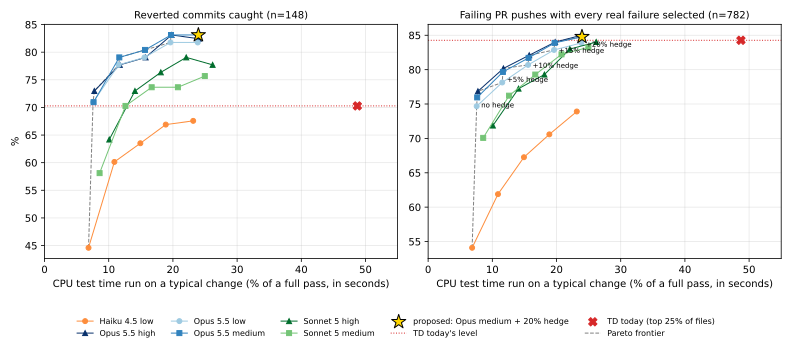

# LLM test selection for PyTorch CI: offline evaluation

**TL;DR.** If PRs picked their tests with one Opus 5.5 call (low effort, plus a 5% TD hedge) instead of today's target determination (TD), CI test-job spend would fall **36%, from $935k to $599k a month** ($336k saved, $61k of it GPU). The p50 wait for pull and trunk would fall from **181 to 96 minutes**. It would also catch more real breakages than TD does today: in a backtest over the 148 commits later reverted for breaking a job that TD runs in, **78% would have failed CI on their PR, against 70% with TD**, and 97.7% of PRs with a reproducible failure would still have gone red, against 96.6%.

- **The idea.** One `claude -p` call per PR push sees the title, description, diff and every candidate test file annotated with its CI minutes, and returns the files worth running.
- **Old and new.** Below, "old" is TD as it runs on PRs today: its top 25% of test files per config, in the workflows that have TD. "New" is the proposed production config: Opus 5.5 at low effort plus TD's top files up to 5% of each config's test time. Main always runs everything in both.
- **The model calls** cost about $2k a month. This stack reaches $286k of the saving, in pull and trunk. The other $50k needs follow-ups: the inductor workflow has to download the selection ($46k), and periodic and slow have to enable TD at all ($4k).
- **The stack.** The selector, harness, run_test.py integration and a shadow-mode CI workflow are in the PRs below this one. Enforcement is opt-in per PR through the `ci-llm-td` label.

The sections up to Time to land compare old and new only. Other models, effort levels and hedge budgets are in [Sweep](#sweep-other-models-efforts-and-hedges), which is how the config was chosen.

## Proposed production config

| | Old | New |
|---|---|---|
| Selector | TD heuristics, top 25% per config | Opus 5.5, effort low, no tools, plus TD's top files up to 5% of the config's test time |
| Safety rules | none | edited or added test files always run; malformed output or changes to test infrastructure run everything |
| Runs on | PRs in TD-enabled workflows | the same |
| Main pushes | everything | everything |

## What the backtest measures

We took 666 historical changes, asked each policy offline which test files it would run, and checked that against which tests really failed. A failure is a (test file, CI config) pair, for example `test_ops.py` in the `default` config. A policy **catches** a change if it would have run at least one of the change's failing files in the config where it failed, which is enough for that CI run to go red. Only failures in jobs that run TD today count: the pull, trunk and ROCm workflows. Jobs elsewhere (inductor's unit tests, periodic, slow, mac-mps, ...) run every test under both policies, so their failures cannot tell the two apart and are left out; a change whose only failures were there is left out too. There are three kinds of change:

- **Reverted commits (n=148).** These are commits that landed on main between 2026-04-01 and 2026-10-25 and that the autorevert bot then reverted because they broke tests. Main runs every test, so we know exactly which files started failing, and in which configs, between the landing and the revert. Of 160 such reverts, 148 broke a TD job, with 193 failures in those jobs; the other 12 broke only jobs without TD. A caught revert is a breakage that the PR's own CI would have flagged before it landed. This is the most important number: TD is not involved in choosing what main runs, so this truth is not biased toward either policy.
- **PRs with a reproduced failure (n=176).** We took 316 PRs from 2026-10-01 to 2026-10-25 whose CI had a test failure we can blame on the PR: no other author's PR failed the same test, and main did not fail it within 4 days. 176 of them have a failure in a TD job that happened again on a rerun or on a later push of the same PR (348 failures). These are real bugs the author introduced, and a caught PR is one whose CI would still have gone red. These PRs ran under TD, so we only see failures in files TD chose to run, which favors old.
- **PRs with any attributable failure (n=282).** These are the same 316 PRs counting every attributable failure in a TD job, including ones seen only once, which are mostly flaky tests. 282 have one. This is the one metric where old is ahead, because TD's heuristics rank historically flaky tests high.
- **Typical changes (n=190).** These are random main commits from 2026-10-01 to 2026-10-25 with no known breakage. **Test time run** is the mean over them of the share of a full CI pass's test-seconds that a policy runs, with CPU and GPU counted separately, over the configs that some TD job runs (the inductor unit-test configs are priced separately below). The dollars come from this number.

"Failures caught" in the table is recall over the individual (file, config) failures instead of per change.

## Accuracy and test time

| | Old | New |
|---|---|---|
| Reverted commits caught (n=148) | 70.3% | 77.7% |
| their failures caught (193) | 63.7% | 72.5% |
| PRs with a reproduced failure caught (n=176) | 96.6% | 97.7% |
| their failures caught (348) | 92.5% | 97.4% |
| PRs with any attributable failure caught (n=282) | 92.2% | 86.9% |
| CPU test time run on a typical change | 48.7% | 11.5% |
| GPU test time run on a typical change | 43.5% | 11.5% |
| Model call, $ per push / p50 latency | - | $0.179 / 8s |

- New catches 26 reverted commits that old misses, and old catches 15 that new misses. On PRs with a reproduced failure the split is 6 and 4.
- Old's numbers come from a replay of today's TD that is optimistic for it; see Caveats.

## Spend and savings

30-day runner cost of test jobs, from `misc.runner_cost`. Builds, lint and other non-test jobs are not counted. Only the PR-triggered part of each workflow changes; main pushes and scheduled runs keep running everything.

| Workflow | Old $k/mo | New $k/mo |
|---|---|---|
| pull, CPU | 463.6 | 274.2 |
| trunk, CPU | 157.0 | 107.1 |
| trunk, GPU | 158.0 | 111.5 |
| inductor, CPU (follow-up) | 79.0 | 43.1 |
| inductor, GPU (follow-up) | 54.5 | 44.0 |
| periodic, GPU (follow-up) | 17.0 | 13.3 |
| slow, CPU (follow-up) | 6.3 | 6.0 |
| **total** | **935** | **599** |
| model calls | 0 | 2.0 |

- **Saved:** $336k a month, $275k CPU and $61k GPU. The first three rows, which this stack covers, are $286k.
- **Follow-ups.** Inductor ($46k) needs `inductor.yml` to download the selection. Periodic and slow ($4k) run every test on PRs today because run_test.py turns TD off outside pull, trunk and ROCm, and the selection is only enforced where TD is on; those rows assume TD is extended to them.
- **Why 36% and not 75%.** New runs about 75% less PR test time than old, but three things dilute that. $241k a month is main and scheduled runs, which keep running everything. $47k is the inductor model benchmarks, which PRs trigger but which are not test files. And the 20% fixed job overhead is not saved (see Dollar model). The selectable PR spend is $647k, and new saves 52% of it.
- In inductor only the run_test.py unit-test configs are selectable. The model benchmarks (huggingface, timm, torchbench) are most of its GPU spend and are not test files.
- **Not in the table:** rocm-mi300 and the other ROCm workflows also download the selection, but their runners are carried at $0 in `misc.runner_cost`, so they show up only under Time to land and Capacity. The remaining callers (win, mac, s390x, xpu) cost under $1k a month together or are also carried at $0.

## Time to land

| Wait for a PR push | Old (min) | New (min) |
|---|---|---|
| pull and trunk, p50 | 181 | 96 |
| pull and trunk, p90 | 291 | 179 |
| pull and trunk, mean | 205 | 112 |
| pull, trunk and inductor, p50 | 191 | 120 |
| pull, trunk and inductor, p90 | 442 | 389 |
| `@pytorchbot merge` that starts trunk, comment to merge, p50 | 185 | ~92 |
| `@pytorchbot merge` that starts trunk, comment to merge, p90 | 269 | ~180 |

Time to signal (TTS) per workflow, in minutes:

| Workflow | PR runs | Old p50 | New p50 | Old p90 | New p90 |
|---|---|---|---|---|---|
| pull | 6,400 | 70 | 43 | 95 | 77 |
| trunk | 2,981 | 182 | 92 | 277 | 180 |
| inductor | 3,719 | 136 | 111 | 223 | 180 |
| rocm-mi300 | 455 | 208 | 82 | 313 | 188 |

- **Merge wait.** 1,643 PR heads ran pull and `ciflow/trunk` together. On those, the p50 drops by 1.4 hours and the p90 by 1.9 hours. Trunk is the later signal for 100% of them in old and 98% in new. With `ciflow/inductor` as well (1,186 heads), the inductor benchmarks bound the wait.
- **Trunk is where the latency is.** Its long test shards are the critical path, so all of the test shrinkage shows up as wall-clock time.
- **Pull becomes build-bound.** Runs that wait on a build go from 12% to 55%. The floor is the xpu build (p50 40 / p90 49 min from creation to done) and the ROCm build (p50 23 / p90 53). Faster builds are the next lever for pull.
- **The model matches real merges.** When the merge comment started trunk (n=337), comment to merge took p50 185 / p90 269 min, against a simulated trunk TTS of 182 / 277. When trunk had already run before the comment (n=533), the merge took p50 3 min.
- **CI is a minority of end-to-end time to land.** From the first pull run on the merged head to the merge is p50 15.8 h and p90 94.5 h, dominated by review. The saving matters most for authors iterating on red CI, where every push pays it again.

**Capacity.**
- PR test job-hours across pull, trunk, inductor and rocm-mi300 go from 675k to 265k a month. `Test` is 70-95% of test-job time on every major runner type.
- Median runner queues are already 1-3 minutes. The tails are long: a10g p90 14 min, l4 p90 11, macos-m1 p90 59, mi300 p90 56, and the 4-GPU a10g pool p50 11 / p90 135. Freed capacity should cut those tails; this is a qualitative argument, not a model.

**Method.**
- For every PR workflow run in the 30 days to 2026-11-03, each test job's `Test` step is shrunk by the ratio r of new to old test time for that job. Each job keeps its start time. Builds and non-test jobs are unchanged, shards are not rebalanced, and queueing effects are ignored.
- In pull, trunk and rocm-mi300, r is 0.237 (CPU) and 0.264 (GPU), from the typical-change test-time shares in Dollar model below. In inductor, which has no TD, r is 0.123 / 0.187 for the unit-test configs and 1 for the model benchmarks.
- TTS is the last job's completion minus the run's creation. Only first attempts are used. Cancelled runs, runs with a cancelled job, and runs that failed before any build are excluded.
- Only about 30% of PR pull runs survive the filters; most of the rest are superseded pushes that were cancelled. About 2.8k pull and 2.3k trunk runs failed in runner-determinator before any build, which looks like an infra issue worth a separate look.
- r is one ratio per workflow and runner kind, applied to every shard. An unbalanced selection, where one shard keeps most of the selected tests, would make the real latency win smaller.

## Dollar model

- The selectable part of each test job is the Test step. Outside it, checkout, docker pull, build download and teardown take a median of 4.3 to 4.8 minutes, about 12-15% of the job. The model assumes a fixed overhead fraction of 0.2 for that.
- A job's relative cost is `0.2 + 0.8 * f`, where f is the share of test time it runs. For old, f is the replayed TD share in TD workflows and 1 elsewhere. The PR share of each workflow's test hours is then rescaled by new over old.
- **Test-time shares.** pull, trunk, periodic and slow use the typical-change shares from the Accuracy table, which are over the configs TD jobs run, so the periodic and slow rows are approximations ($4k together): old 48.7% CPU / 43.5% GPU, new 11.5% / 11.5%. The inductor rows use the configs of inductor-unittest.yml that no TD job runs (`inductor_core`, `inductor_cpp_wrapper`, `inductor_distributed`, `inductor_amx`, `inductor_aoti_fallback`, `inductor-halide`, `inductor-triton-cpu`), over only the 69 of 190 neutral commits that match the `ciflow/inductor` autolabel globs, since those are the PRs that run it; on those, new runs 12.3% of CPU and 18.7% of GPU unit-test time. trunk's own `inductor` config has TD and is priced with trunk.
- **Model cost.** $0.179 per call is the mean over all 666 samples, a conservative basis since neutral commits average $0.139. At about 11.4k PR pushes a month that is $2.0k a month. The same basis is used for every policy in Sweep.

The overhead fraction dominates the uncertainty:

| Overhead | CPU saved | GPU saved | Total saved |
|---|---|---|---|
| 0.1 | $336k | $74k | $410k/mo |
| **0.2** | **$275k** | **$61k** | **$336k/mo** |
| 0.35 | $201k | $44k | $245k/mo |
| 0.5 | $141k | $31k | $172k/mo |

**Where the GPU money is.**
- The GPU number is modest because the biggest GPU line, the inductor model benchmarks, is not selectable test files.
- The same approach can gate them: ask the model whether a change can affect compiled-model performance or accuracy at all, which is a yes/no question rather than a file list. That is step 5 of the rollout.
- Skipping shards whose selection is empty would also recover the job overhead the model assumes is fixed.

## Method

**Unit of selection.**
- The unit is a test file under `test/`. Selecting a file runs it in every config it belongs to: default, distributed, slow, inductor and so on.
- The two wrapper sweeps, `dynamo_wrapped` and `crossref`, re-run hundreds of ordinary files in a special mode. The model requests them separately; an unrequested sweep runs only the selected files.
- The model can also request whole directories (`dynamo`, `inductor`, ...) or `run_all`.

**Safety rules.** `Selection.from_model_output` applies these on top of the model's answer:
- A test file the PR edits or adds is always selected.
- The answer becomes run-all when it is missing or malformed, or when the change touches anything that decides how tests run. That covers run_test.py, conftest, common_utils, common_device_type, tools/testing, the test shell scripts and actions, and the CI docker images.

**Hedge.** The 5% hedge adds TD's highest-ranked files with a positive score until they fill 5% of the config's test time (all shards together), each file charged once. A file that does not fit is skipped and filling continues. The harness replays exactly what run_test.py does.

**Cost.**
- Cost is the share of one full CI pass's test-seconds that a selection runs, from `test-times.json`, per config. Configs that no TD job runs are left out; the inductor unit-test ones are priced separately.
- Jobs are classified from `.github/workflows`: by name and config, then with CUDA and Python versions wildcarded (CI has moved to newer ones since the oldest reverts), then by config alone. A reusable workflow's jobs take their caller's TD setting, so `dynamo-unittest` jobs (called from trunk) have TD and `unit-test / ...` jobs (called from inductor) do not.
- `test-times.json` is merged over jobs per config, so a config that TD and non-TD jobs share, like `default` in periodic, is priced as one.
- Seconds are summed over every build environment. Environments matching `cuda|rocm|sm\d+|xpu|h100|b200|a100|gpu` count as GPU.

**Dataset** (`eval/build_dataset.py`, ClickHouse plus git). There are three kinds of sample:

| Kind | n | Window | Truth |
|---|---|---|---|
| PR | 316 | 2026-10-01 to 10-25 | Test files that failed on the PR head and that we can blame on the PR: no other author's PR failed the same test, and main did not fail it within 4 days. "Strong" truth keeps only failures that reproduced on a second run or a later head; 185 PRs have one, and 176 of those have one in a TD job, which is the n scored throughout. |
| revert | 160 | 2026-04-01 to 10-25 | Main commits the autorevert system reverted. The truth is the failures that appeared between landing and the revert, with their configs. |
| neutral | 190 | 2026-10-01 to 10-25 | Random main commits, with no truth. They measure how much a selector runs on a typical change, which is what the dollars depend on. |

Reverts are the most informative sample. On PRs in TD-enabled workflows, we only ever observe failures in the files TD already chose to run, so PR truth is censored toward TD's picks. Main runs everything, so revert truth is not censored this way.

**Prompt development.**
- The prompt (`prompt.md`) was iterated on a disjoint 436-sample dev set (`eval/ids/dev.txt`).
- The 10 neutral pilot samples that were looked at while writing it were removed from the reported set, leaving 666 (`eval/ids/eval.txt`; its neutral part is `eval/ids/neutral.txt`). One of the 190 neutral commits was later reverted; build_dataset now excludes reverted commits from neutral draws.
- Every model ran the same prompt and the same samples, with no tools. Median input was about 30k tokens; the candidate list is about 1,100 files.

**TD baseline.**
- `eval/td_replay.py` runs today's in-repo TD heuristics on each sample's changed files and commit text, then takes the top 25% cut CI uses, per config.
- The heuristics read today's historical-stats artifacts, which already contain these failures. The replay is therefore optimistic for TD.

## Sweep: other models, efforts and hedges

This section is how the production config was chosen. Rows use the same samples and definitions as [What the backtest measures](#what-the-backtest-measures); $/call is the mean over all 666 samples; p50 wall is the model call alone.



Each point is one model and effort level. Filled points are the selection as the model returns it, after the safety rules. Hollow points add the 5% TD hedge. The red square is the replayed TD. The x axis is the GPU share of the sample's own CI pass, which is higher than on a typical change because failing changes are larger. The PR panel uses the 176 PRs with strong truth.

**Models and effort levels, no hedge:**

| Model / effort | PR caught | PR failures | Revert caught | Revert failures | Typical CPU | Typical GPU | $/call | p50 wall |
|---|---|---|---|---|---|---|---|---|
| Haiku 4.5 low | 84.1% | 75.3% | 44.6% | 42.0% | 6.9% | 6.9% | $0.064 | 32s |
| Haiku 4.5 high | 85.8% | 77.3% | 45.9% | 43.0% | 6.9% | 6.9% | $0.064 | 32s |
| Sonnet 5 low | 95.5% | 92.2% | 54.1% | 50.3% | 8.7% | 8.2% | $0.102 | 5s |
| Sonnet 5 medium | 94.9% | 92.0% | 58.1% | 52.3% | 8.6% | 8.4% | $0.110 | 11s |
| Sonnet 5 high | 94.9% | 92.5% | 64.2% | 59.6% | 10.1% | 9.6% | $0.127 | 23s |
| Opus 5.5 low | 97.2% | 95.1% | 70.9% | 65.8% | 7.6% | 7.3% | $0.179 | 8s |
| Opus 5.5 low (rerun) | 98.3% | 96.0% | 67.6% | 61.1% | 7.8% | 7.5% | $0.178 | 8s |
| Opus 5.5 medium | 98.3% | 96.6% | 70.9% | 66.3% | 7.6% | 7.5% | $0.192 | 14s |
| Opus 5.5 high | 98.3% | 97.4% | 73.0% | 67.9% | 7.8% | 7.7% | $0.201 | 18s |
| TD today (old), for reference | 96.6% | 92.5% | 70.3% | 63.7% | 48.7% | 43.5% | - | - |

**With the 5% hedge:**

| Model / effort | PR caught | PR failures | Revert caught | Revert failures | Typical CPU | Typical GPU | Saved $k/mo | Model $k/mo |
|---|---|---|---|---|---|---|---|---|
| **Opus 5.5 low (production)** | **97.7%** | **97.4%** | **77.7%** | **72.5%** | **11.5%** | **11.5%** | **336** | **2.0** |
| Opus 5.5 high | 98.3% | 97.7% | 77.7% | 73.6% | 11.7% | 11.9% | 334 | 2.3 |
| Sonnet 5 medium | 97.7% | 96.8% | 70.3% | 65.3% | 12.6% | 12.5% | 326 | 1.3 |
| Haiku 4.5 low | 89.8% | 84.2% | 60.1% | 56.5% | 10.9% | 11.0% | 342 | 0.7 |

Opus 5.5 low without the hedge would save $369k but catches 6.8 points fewer reverts, which leaves it level with TD (70.9% vs 70.3%). Haiku saves more only because it runs less, and catches 18 points fewer reverts than production.

**Hedge budgets, Opus 5.5 low:**

| Hedge | Revert caught | Typical CPU |
|---|---|---|
| 0% | 70.9% | 7.6% |
| **5% (production)** | **77.7%** | **11.5%** |
| 10% | 79.1% | 15.6% |
| 15% | 81.8% | 19.6% |
| 20% | 81.8% | 23.9% |

The budgets are not nested: the hedge skips a file that does not fit and keeps filling, so a larger budget can take one large file in place of several small ones. A larger budget therefore does not always catch more; 20% catches no revert that 15% misses.

**What the sweep shows.**
- **Model size matters more than effort.** Opus at low effort beats Sonnet at high effort on reverts (70.9% vs 64.2%) and is about 3x faster (8s vs 23s p50).
  - Effort helps Opus by about two points on reverts (70.9% low and medium, 73.0% high), which is within run-to-run noise.
  - Haiku 4.5 does not support the effort setting, so its two runs are effectively replicates. It is not good enough on reverts.
  - Sonnet sometimes fails to produce schema-valid output after retries: 12 of 666 samples at low effort. Those fall back to run-all, which is safe but costs.
- **Spend goes almost entirely on run-all.**
  - Without the safety rules, Opus low alone runs about 3.2% of test time on a typical change.
  - The run-all rules fire on 10 of 190 typical changes, mostly edits to `.ci/pytorch/test.sh` and the test docker images, and account for most of the rest of the 7.6%.
  - Narrowing those rules is the cheapest remaining lever. They were kept broad because 8 of the 160 reverts are docker image changes.
- **The LLM and TD miss different things.** On reverts, Opus low (no hedge) catches 24 that TD misses, and TD catches 23 that Opus misses; their union catches 128 of 148 (86%). This is why the hedge matters: alone, each catches about 70%. Running all of TD's top 25% on top of the model would cost what TD costs now, which is why the hedge is a small budget. 5% is the recommended start because many of the misses it leaves are label noise.
- **Run-to-run variance is about 3 points.** Two identical Opus low runs give 70.9% and 67.6% on reverts, so differences of 2 or 3 points between neighbors are not significant.

**Revert misses.** Opus high (no hedge) misses every failure on 40 of the 148 reverts. The AI assistant that wrote this stack hand-checked the misses on an earlier version of the revert truth and scoring (39 of them); a human has not reviewed them.
- About a quarter are not plausibly caused by the reverted commit; they are label noise. Examples:
  - a torchtitan pin bump labeled with a test_testing failure;
  - a docs change labeled with libtorch_agnostic;
  - a shard propagation change labeled with test_max_autotune;
  - a `gc.collect` change labeled with a torch_np dtype test.
- The real misses are mostly generic sweeps. Examples:
  - an OpInfo edit that broke functorch/test_ops;
  - a gradcheck change that broke test_ops;
  - docker image changes, now covered by the run-all rule.
- The prompt already calls these out. They are the next target for prompt iteration, and the shadow metrics will say whether they happen in practice.

**Agentic mode.**
- **Setup.** Sonnet 5 medium was rerun on 169 of the samples (80 PR, 60 revert, 29 neutral) with Read/Grep/Glob over a checkout of the change.
- **It made no difference.** Revert recall was identical, 30 of the subset's 56 scored reverts (53.6%) with and without tools. On the subset's 49 PRs with a reproduced failure, it dropped from 46 (93.9%) to 45 (91.8%).
- **The model rarely used the tools.** In about 63% of samples it answered without calling one.
- **It added cost and latency.** Per call it cost $0.150 vs $0.134 on PRs and $0.116 vs $0.095 on reverts, and p90 latency rose from 29s to 37s.
- **Opus without tools is better.** On the same subset, Opus 5.5 low with no tools catches all 49 PRs (100%) and 40 of the 56 reverts (71.4%).
- **Conclusion.** Spend on a bigger model, not on letting a smaller one explore. CI runs with `--tools ""`, which also removes any route for PR content to drive file reads.

## Caveats

- **The TD replay is optimistic.** It uses today's heuristic stats, which include these failures. PR truth is also censored toward TD's picks. Both favor old. Failures in jobs without TD (inductor unit tests, periodic, slow, ...) are left out because both policies run everything there; scoring them as caught for both would add the same 12 reverts to each side (79.4% vs 72.5% of all 160).
- **Label noise.** About a quarter of the remaining revert misses look unrelated to the reverted change, so true revert recall is higher than reported.
- **Training-data contamination.** Reverts before mid-2026 may predate the models' knowledge cutoff. The PR samples (October 2026) do not, and they show the same ordering of models.
- **Prompt injection.**
  - A PR's description or diff can try to talk the model into selecting nothing.
  - Mitigations: enforcement is opt-in per PR through the `ci-llm-td` label; the selector workflow runs only for pytorch/pytorch branches, from main's copy of the workflow and code, and reads the PR only through git; main always runs everything.
  - The worst case is the same as a TD miss today: a regression is caught on main and reverted.
- **Deployment noise.** The CI workflow uses the existing `bedrock` environment. Its behavior there (latency, throttling) is not measured here. The shadow metrics are what will measure it.

## Rollout

1. **Shadow (this stack).**
   - `llm-td.yml`, a `pull_request_target` workflow, writes a selection for every internal PR push as the artifact `llm_td_selection_<PR number>_<head sha>`.
   - The test jobs' download-td-artifacts step accepts that artifact only from an `llm-td.yml` `pull_request_target` run for the same PR and head in this repository, so another workflow or PR cannot plant one.
   - run_test.py logs `llm_td_shadow_selection` and `llm_td_shadow_failure`. The second metric is a live recall measurement: every failing test, with whether the selection (hedge included) covered it.
   - Gate the next step on a few weeks of it matching the numbers above.
2. **Opt-in enforcement.** `ci-llm-td` enforces the selection, with the 5% hedge, on that PR.
3. **Default enforcement.** Enforce on every internal PR, keeping the label as an opt-out (or `ci-no-td`). This unlocks about $286k a month and the merge-wait drop above.
4. **Inductor, periodic and slow.** Have `inductor.yml` download the selection, and let run_test.py enforce it in periodic and slow, where TD is off today. Inductor's unit tests are the largest relative saving, about $46k a month; periodic and slow are about $4k.
5. **Benchmarks and shards.** Gate the inductor model benchmarks on a yes/no model answer, and skip shards with nothing selected.

## Reproducing

The reported PR and neutral samples come from 2026-10-01 to 2026-10-25 and the reverts from a wider window starting 2026-04-01, so build_dataset runs twice into the same `$DATA` (`--end` is exclusive). The sample ids the report is scored on are checked in under `eval/ids/`. A fresh build will not match them exactly, since ClickHouse and main keep moving; the numbers above were scored from `samples_v2/` and `td_v2/`, the outputs of rerunning build_dataset and td_replay after the revert-truth fix.

```
python -m tools.testing.llm_td.eval.build_dataset --data $DATA --start 2026-10-01 --end 2026-10-26 --kinds pr neutral
python -m tools.testing.llm_td.eval.build_dataset --data $DATA --start 2026-04-01 --end 2026-10-26 --kinds revert
IDS=tools/testing/llm_td/eval/ids
python -m tools.testing.llm_td.eval.run_eval --data $DATA --tag v2_opus55_low --model us.anthropic.claude-opus-5-5 --effort low --ids $IDS/eval.txt
python -m tools.testing.llm_td.eval.td_replay --data $DATA
S="python -m tools.testing.llm_td.eval.score --data $DATA --ids $IDS/eval.txt"
$S --policies model,final,final+td5 --json rows.json v2_opus55_low td
$S --policies final+td5,final+td10,final+td15,final+td20 v2_opus55_low
$S --all-truth --policies final,final+td5 v2_opus55_low td
python -m tools.testing.llm_td.eval.dollars --data $DATA --overhead 0.2 v2_opus55_low final+td5
python -m tools.testing.llm_td.eval.chart rows.json tools/testing/llm_td/report_tradeoff.svg
```
